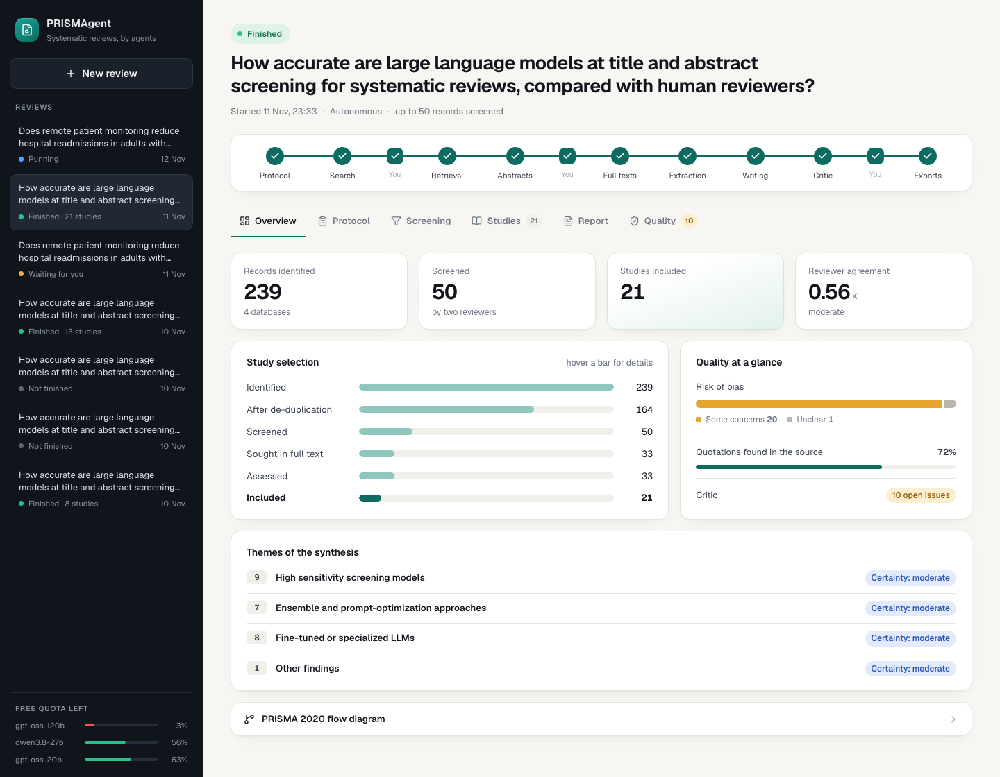
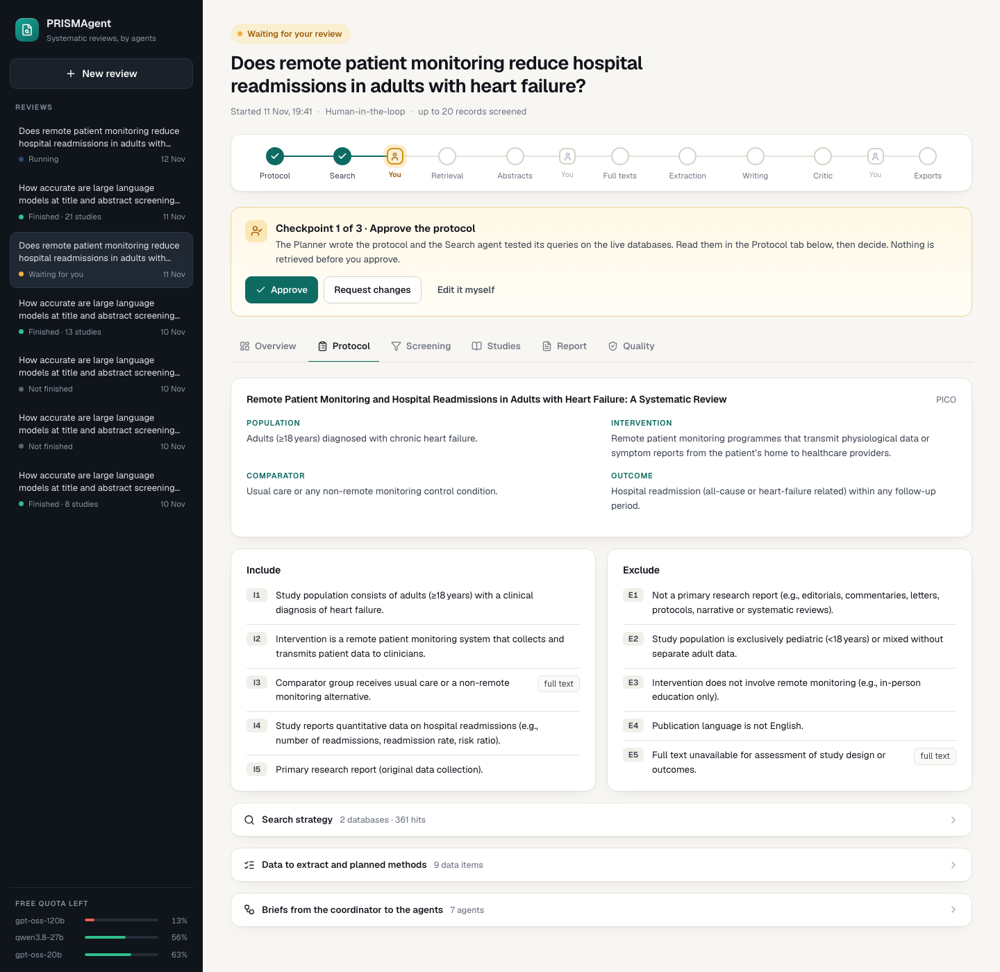
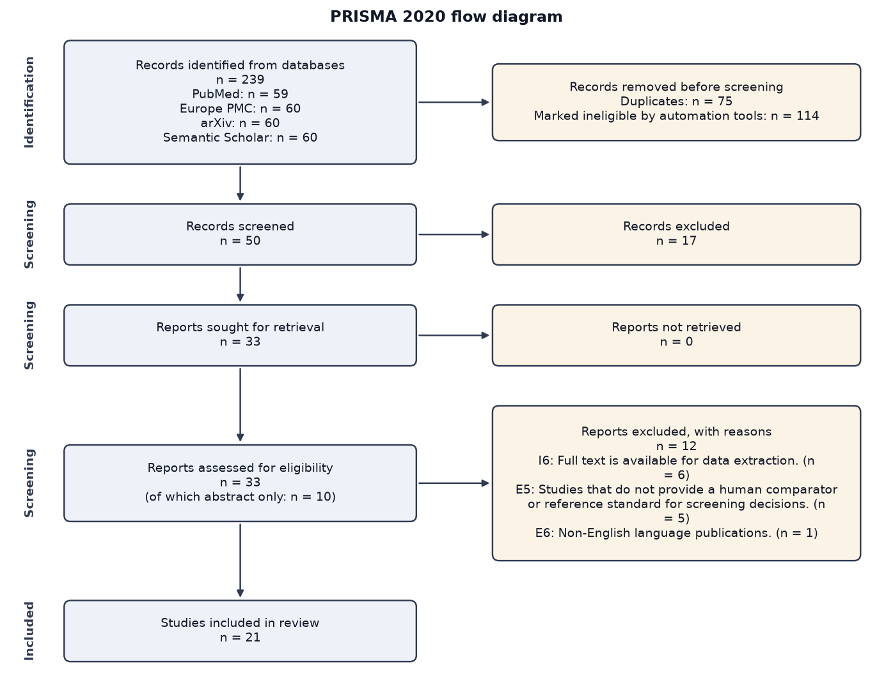

# PRISMAgent — an agentic AI pipeline for systematic reviews

A multi-agent system that takes a research question and carries out a complete systematic
literature review following PRISMA 2020: protocol, search strategy, multi-database retrieval,
de-duplication, dual screening, full-text assessment, data extraction, risk-of-bias appraisal,
synthesis, and a referenced manuscript — with every decision logged and reproducible.

Built with **LangGraph / LangChain** (orchestration, tool calling, checkpointing, human-in-the-loop)
and a **hybrid RAG pipeline** (dense + BM25 retrieval, cross-encoder re-ranking, contextual
compression) over the retrieved literature.

| | |
|---|---|
| Demonstration review | [`examples/demo_run/report.md`](examples/demo_run/report.md) ([Word version](examples/demo_run/report.docx)) |
| Technical report | [`docs/TECHNICAL_REPORT.md`](docs/TECHNICAL_REPORT.md) |
| Evaluation results | [`docs/evaluation/`](docs/evaluation/) |
| Protocol template | [`config/protocol_template.yaml`](config/protocol_template.yaml) |

---

## 1. How it works


Every stage returns to the coordinator, which picks the next unfinished stage. There are three
loops: the human can send the protocol back to the planner, the critic can send the manuscript back
to the writer, and the human can request a final revision.

### The agents

| Agent | Code | What it does | Default model |
|---|---|---|---|
| Coordinator / Planner | [`graph.py`](src/sysrev/graph.py), [`agents/planner.py`](src/sysrev/agents/planner.py) | Routes the workflow; writes the protocol from the template; writes a topic-specific brief for each other agent | gpt-oss-120b |
| Search Strategy | [`agents/search_strategy.py`](src/sysrev/agents/search_strategy.py) | Concept blocks (synonyms, MeSH); one query per database in its own syntax; calls the `test_query` tool to count hits and refines | gpt-oss-120b |
| Retrieval | [`agents/retrieval.py`](src/sysrev/agents/retrieval.py) | Runs the searches, de-duplicates, applies date limits, builds the index, ranks records when there are more than the screening budget, fetches open-access full texts | no LLM |
| Screening (two stages) | [`agents/screening.py`](src/sysrev/agents/screening.py) | Two independent reviewers on two different models, an adjudicator for conflicts, a rationale and criterion id for every decision, Cohen's kappa | gpt-oss-20b (A), qwen3.8-27b (B), gpt-oss-120b (adjudicator) |
| Extraction and Appraisal | [`agents/extraction.py`](src/sysrev/agents/extraction.py) | Structured extraction with a verbatim quotation per value, verified in code against the source; risk of bias with the tool matching the design | gpt-oss-120b (extraction), gpt-oss-20b (appraisal) |
| Synthesis and Writing | [`agents/synthesis.py`](src/sysrev/agents/synthesis.py) | Themes, narrative synthesis with citations, certainty ratings, meta-analysis preparation, evidence map, full PRISMA-structured manuscript | gpt-oss-120b |
| Critic / QA | [`agents/critic.py`](src/sysrev/agents/critic.py) | Rule-based checks (PRISMA flow arithmetic, checklist, citations, quotations) and LLM audits on a different model (faithfulness, overstatement, re-screening of excluded records, eligibility of included studies) | qwen3.8-27b |

Which model does which task is configuration (`ROLE_*` variables, see section 4).

### RAG pipeline

[`rag/index.py`](src/sysrev/rag/index.py): abstracts and open-access full texts are chunked
(section-aware), embedded locally (`BAAI/bge-small-en-v1.5`, ONNX) into **Chroma**, and indexed with
**BM25**. A query runs both retrievers, fuses the rankings (reciprocal rank fusion), re-ranks with a
cross-encoder (FlashRank, `ms-marco-MiniLM-L-12-v2`), and compresses the passages to the sentences
closest to the query. It is used to: rank records before screening, find the passages relevant to
each eligibility criterion, find the passages for each data item, ground the introduction and the
thematic synthesis, and give the critic the same evidence as the writer.

### Transparency and reproducibility

Each run has its own directory (`runs/<run_id>/`):

| File | Content |
|---|---|
| `manifest.json` | question, options, model per task, package versions |
| `audit.jsonl` | one line per agent action, tool call, routing decision and human decision |
| `llm_trace.jsonl` | every model call: full prompt, response, tokens, latency, cache hit |
| `protocol_v1.json`, `protocol_v2.json`… | every artifact is versioned, never overwritten |
| `search_strategy_v*.json` | concept blocks, final queries, hit counts, every query tested |
| `records_raw.jsonl`, `records.jsonl`, `dedup_log.jsonl` | records before and after de-duplication, with merge reasons |
| `screening_title_abstract.jsonl`, `screening_full_text.jsonl` | both reviewers' votes and rationales, adjudication, final decision |
| `extractions.jsonl`, `evidence_table.csv`, `risk_of_bias.jsonl`, `effects.csv` | extracted data with quotations and their verification status |
| `qa_report.md` | the critic's checks and issues |
| `report.md`, `report.docx`, `references.bib`, `prisma_flow.png`, `evidence_map.png` | final outputs |
| `checkpoints.sqlite` | LangGraph state after every node (resume after a pause or a crash) |

Model calls use temperature 0 and are cached on disk: re-running the same step with the same inputs
replays the same answers at no cost.

---

## 2. Installation

Requirements: Python 3.11–3.13 and about 1.5 GB of disk (dependencies and two small local models).
The web interface also needs [Node.js](https://nodejs.org) 20 or later; the command line works without it.

```bash
git clone https://github.com/manal-0603/PRISMAgent.git
cd PRISMAgent

# with uv (recommended)
uv venv --python 3.12
source .venv/bin/activate
uv pip install -e ".[dev]"

# or with pip
python3.12 -m venv .venv
source .venv/bin/activate
pip install -e ".[dev]"
```

`requirements-lock.txt` lists the exact versions the project was developed and tested with; if a
newer release of a dependency breaks something, install from it first
(`uv pip install -r requirements-lock.txt`, then `uv pip install -e . --no-deps`).

All commands below assume the virtual environment is activated.

The first run downloads the embedding model (about 65 MB) and the re-ranker (about 35 MB) into
`.cache/`.

## 3. Configuration

```bash
cp .env.example .env
```

Then put your key in `.env`:

```
GROQ_API_KEY=gsk_...
```

A free key is created at <https://console.groq.com> (API Keys → Create API Key). `.env` is listed in
`.gitignore`; never commit it.

No other key is needed: PubMed, Europe PMC, OpenAlex, arXiv and Semantic Scholar are used through
their public APIs. Optional keys (`OPENALEX_API_KEY`, `S2_API_KEY`, `NCBI_API_KEY`) only raise rate
limits. Your e-mail address is sent to those services only if you set `CONTACT_EMAIL`.

### Free-tier quotas

The Groq free tier allows, per model, 8,000 tokens per minute and **200,000 tokens per day**. The
pipeline is built around that constraint: a token-aware rate limiter, an on-disk cache, compact
prompts, and tasks spread over three models. Even so, a review with the default options (50
records screened, two revision rounds) can need more than one day of the primary model's quota: the
demonstration used about 225,000 tokens of it and took 10.5 hours, most of them waiting (section
5). To make a run fit in the daily quota, screen fewer records (`--max-screen 24`), allow one
revision round (`--qa-rounds 1`), or give extraction to the smaller model (`ROLE_EXTRACTOR=fast`).
Check your usage at any time:

```bash
sysrev quota
```

If the daily quota runs out, the run stops with a clear message and nothing is lost: run
`sysrev resume <run_id>` later (the quota regenerates continuously, about 8,000 tokens per hour
per model). If it runs out during a revision round, the run finishes with the reviewed draft and
`sysrev revise <run_id>` applies the revision afterwards. Setting `LLM_MAX_WAIT_SECONDS=3600` lets
an unattended run wait for the quota instead of stopping. On a paid plan, raise
`TOKENS_PER_MINUTE` in `.env` and the `--max-per-source` / `--max-screen` options.

## 4. Usage

### Command line

The command-line tool is called `sysrev`.

```bash
# interactive review: stops at three checkpoints for your approval
sysrev run "Does remote monitoring reduce readmissions in adults with heart failure?"

# fully autonomous review
sysrev run "your question" --auto

# options
sysrev run "your question" --max-per-source 60 --max-screen 50 \
    --databases pubmed,europepmc,openalex --fulltext-fallback abstract --qa-rounds 2

sysrev list                 # runs on disk
sysrev status <run_id>      # progress and headline numbers
sysrev resume <run_id>      # continue after a checkpoint, a crash or a quota stop
sysrev revise <run_id>      # send a finished run back to the writer with the critic's open issues
sysrev rebuild <run_id>     # regenerate the report and exports without new model calls
sysrev export <run_id> examples/my_review   # copy the shareable artifacts of a run
sysrev evaluate <run_id>    # evaluation report of a finished run
sysrev quota                # tokens and requests used over the last 24 hours
sysrev web                  # web interface on http://localhost:3000 (see below)
sysrev benchmark            # list benchmark datasets
sysrev benchmark --dataset Appenzeller-Herzog_2020 --n 60   # screening vs human labels
```

| Option | Default | Meaning |
|---|---|---|
| `--auto` | off | auto-approve the three human checkpoints (recorded as such in the report) |
| `--max-per-source` | 60 | records fetched per database, most relevant first |
| `--max-screen` | 50 | records sent to screening; if more are retrieved, the most relevant are kept and the others are counted in the PRISMA diagram as removed by automation |
| `--databases` | chosen by the planner | override: `pubmed,europepmc,openalex,arxiv,semantic_scholar` |
| `--fulltext-fallback` | `abstract` | when no open-access full text exists: assess on the abstract (flagged), or `exclude` as not retrieved |
| `--qa-rounds` | 2 | maximum critic → writer revision rounds |
| `--template` | `config/protocol_template.yaml` | protocol template |

### Human checkpoints

| Checkpoint | You see | You can |
|---|---|---|
| 1. Protocol and search | protocol, queries, hit counts | approve; describe changes (the planner revises, the search is redone); edit the protocol yourself |
| 2. Screening | every title/abstract decision with both votes and rationales, kappa | approve; override any decision |
| 3. Manuscript | the draft and the critic's report | approve; request a revision |

Human decisions are logged and reported in the Methods section of the manuscript. A run stopped at
a checkpoint can be closed and resumed later.

### Web interface

```bash
sysrev web
```

then open <http://localhost:3000>. The command starts two things: the Python API
(`src/sysrev/api.py`, FastAPI, port 8000) and the Next.js application in [`web/`](web/) (port
3000). The first start installs the JavaScript packages, which takes about a minute.

Start a review from a question, follow its twelve stages on the progress strip (round nodes are
agents, square ones are your three checkpoints), and answer each checkpoint in place: approve the
protocol, ask the planner for changes or edit it yourself; flip any screening decision; approve
the manuscript or send it back to the writer. Six tabs show the headline of each part of the
review; the detail is one click away:

| Tab | At a glance | On demand |
|---|---|---|
| Overview | key numbers, study-selection funnel, risk of bias, share of quotations found, themes | PRISMA flow diagram |
| Protocol | question framework, inclusion and exclusion criteria | search strategy and queries, data items, coordinator briefs |
| Screening | counts, agreement, every decision, filters | click a record: both reviewers' rationales and how a disagreement was settled |
| Studies | one card per included study | extracted data with quotations, findings, risk-of-bias domains |
| Report | the manuscript, with Word, Markdown, BibTeX and evidence-table downloads | |
| Quality | the critic's open issues, one line each | full issue and suggested fix, evaluation, audit trail |

The sidebar lists the reviews with their state and shows an estimate of the free quota left for
each model.

To browse the demonstration review without running anything or setting a key:

```bash
RUNS_DIR=examples sysrev web
```





More screenshots: [studies](docs/screenshots/studies.png), [quality report](docs/screenshots/quality.png).

Without Node.js, an earlier single-file interface with the same six tabs is still available:
`streamlit run app/streamlit_app.py`.

### Protocol template

[`config/protocol_template.yaml`](config/protocol_template.yaml) is aligned with PRISMA-P. Values
under `fixed` are imposed on the planner (framework, date range, languages, databases, study
designs, mandatory criteria and data items); text under `guidance` tells it how to write each
field; `administrative` holds the registration, funding and competing-interest statements printed
in the manuscript.

### Choosing models

In `.env`:

```
LLM_PROVIDER=groq                 # groq | ollama | anthropic | openai
MODEL_PRIMARY=openai/gpt-oss-120b
MODEL_SECONDARY=qwen/qwen3.8-27b
MODEL_FAST=openai/gpt-oss-20b
ROLE_EXTRACTOR=primary            # any task can be moved: ROLE_PLANNER, ROLE_SEARCH, ROLE_REVIEWER_A,
ROLE_CRITIC=secondary             # ROLE_REVIEWER_B, ROLE_ADJUDICATOR, ROLE_EXTRACTOR, ROLE_APPRAISER,
                                  # ROLE_WRITER, ROLE_CRITIC, ROLE_AUDITOR, ROLE_UTILITY
```

Keep reviewer A and reviewer B on different models, and the critic on a different model from the
writer. For `anthropic` or `openai`, also install `langchain-anthropic` or `langchain-openai`.

---

## 5. Demonstration

Question: *How accurate are large language models at title and abstract screening for systematic
reviews, compared with human reviewers?* Run in autonomous mode on the Groq free tier, with the
default options.

```bash
LLM_MAX_WAIT_SECONDS=3600 sysrev run "How accurate are large language models at title and abstract screening for systematic reviews, compared with human reviewers?" --auto
```

| Stage | Result |
|---|---|
| Protocol | PICO question, 6 inclusion and 6 exclusion criteria (3 marked "full text only"), 8 data items; the planner chose PubMed, Europe PMC, arXiv and Semantic Scholar |
| Search strategy | 2 concept blocks, 7 queries tested on the live databases; final hits: PubMed 78, Europe PMC 90, arXiv 393, Semantic Scholar 123 |
| Retrieval | 239 records (up to 60 per database), 75 duplicates merged, 164 unique; the 50 most relevant were screened, 114 reported as removed by automation |
| Title/abstract screening | 33 retained, 17 excluded; Cohen's kappa between the two reviewers 0.56; 10 conflicts adjudicated; 3 exclusions that rested only on a "full text only" criterion were blocked |
| Full-text screening | 23 open-access full texts retrieved and indexed, 10 reports assessed on the abstract; 21 included, 12 excluded with reasons (6 no full text available, 5 no human comparator, 1 not in English); kappa 0.64; 6 conflicts adjudicated |
| Extraction and appraisal | 21 studies, all read from full text; 133 of 186 supporting quotations found in the source (72%); tools chosen: QUADAS-2 (14), ROBINS-I (5), PROBAST (2); 20 studies "some concerns", 1 "unclear" |
| Synthesis | 4 themes, certainty rating per theme, 9,700-word manuscript, 22 references, 5 tables, PRISMA diagram and evidence map; one exploratory pooled estimate (sensitivity, 2 studies); 42 of 42 PRISMA items reported |
| Critic, round 1 | 11 issues: 2 unsupported statements, 2 overstatements (abstract, discussion), 2 narratives with too few citations, 3 themes that never cite some of their studies, the low quotation rate, 1 excluded record an independent auditor would include |
| Revision 1, critic round 2 | 7 issues: the flagged text was corrected, but the critic found 2 new unsupported statements and 2 new overstatements |
| Revision 2, critic round 3 | 10 issues: again 2 unsupported statements and 2 overstatements, 1 narrative with too few citations, 3 themes with uncited studies; the revision budget (2 rounds) was used up |
| Cost | 10.5 hours of wall-clock time, 9.2 of them waiting for the daily quota of the primary model; the models answered in 4 minutes in total; 206 model calls, 321 audit events |

Outputs in [`examples/demo_run/`](examples/demo_run/): [`report.md`](examples/demo_run/report.md),
[`report.docx`](examples/demo_run/report.docx), [`prisma_flow.png`](examples/demo_run/prisma_flow.png),
[`qa_report.md`](examples/demo_run/qa_report.md), [`evaluation.md`](examples/demo_run/evaluation.md),
[`audit.jsonl`](examples/demo_run/audit.jsonl), and every intermediate artifact.



What to know when reading this demonstration:

- **It is a sample.** 50 of the 164 unique records were screened (the relevance cap). The numbers
  describe that sample of the literature, not the whole field.
- **It took 10.5 hours, not one.** With the default options this review needed about 225,000
  tokens of the primary model (extraction 95,000, writing and two revisions 68,000), more than the
  200,000 the free tier gives per day. The quota ran out 47 minutes in, during extraction; from
  there the run waited for it to refill and advanced one call at a time. Everything up to the end
  of extraction took 1.2 hours. See "Free-tier quotas" in section 3 for ways to make a run fit.
- **The revision loop did not converge.** Each rewrite fixed what the critic had flagged and
  introduced other errors: 11 issues, then 7, then 10. One error survived both revisions (a record
  count of 16,670 where the study says 16,669). Seven major issues remain open, five of them for
  the writer; [`qa_report.md`](examples/demo_run/qa_report.md) lists them under the verdict "not
  resolved" and the manuscript says so in its Methods. The text needs a human edit.
- **72% of the supporting quotations were found in the sources.** 46 of the 53 others are
  fragments that the extractor joined with "…"; the check looks for one continuous passage and
  rejects them. They are flagged "unverified" in the evidence table: not shown to be wrong, but
  not checked either.
- **Six reports were excluded because no open-access full text was found.** The planner wrote
  "full text is available" as an inclusion criterion. A human team would obtain the papers
  instead; this is an availability bias of the run.
- **No human verified anything** (autonomous mode). The manuscript is a draft for expert review.

## 6. Evaluation

The four measures asked for — completeness, accuracy, inter-agent consistency, time savings —
are computed by `sysrev evaluate` from the run artifacts. For the demonstration review
([full report](examples/demo_run/evaluation.md)):

| Measure | Result |
|---|---|
| **Completeness** | 42/42 PRISMA 2020 items reported; PRISMA flow arithmetic consistent; 21/21 included studies extracted and appraised; 109 of 168 data items reported by the studies; 21 of 21 studies read from full text |
| **Accuracy and grounding** | 133/186 extraction quotations located in the source text (72%); 0 citations to non-existent records; 0 of 21 included studies flagged by the eligibility audit; the critic found 2 unsupported statements and 2 overstatements in the first draft, and 2 and 2 again in the final draft after two revision rounds (see section 5) |
| **Inter-agent consistency** | title/abstract: kappa 0.56, raw agreement 80%, 10 conflicts in 50; full text: kappa 0.64, raw agreement 82%, 6 conflicts in 33; independent re-screening of 10 excluded records agreed on 9 |
| **Time** | 10.5 hours of machine time, 9.2 of them waiting for the free daily quota, against an estimated 82.2 person-hours for a manual review of the same workload (50 records, 33 full texts, 21 studies) |

The manual figure is an estimate, not a measurement: it applies per-task assumptions that are
written down in [`config/manual_effort.yaml`](config/manual_effort.yaml) and can be changed.
Restricted to the per-item tasks (screening, full-text assessment, extraction, appraisal), the
estimate is 37.2 person-hours against 1.15 hours. Machine time excludes the time a human needs to
check the output, which a real review still requires. For context, published reviews registered in
PROSPERO took 67 weeks on average from registration to publication (Borah et al., 2017).

The two reviewers agreed less here (kappa 0.56) than in earlier trial runs (0.83 on 24 records):
reviewer A kept 39 of the 50 records and reviewer B 29. Kappa measures agreement between two
models, not agreement with the truth.

### Screening accuracy against human reviewers

`sysrev benchmark` screens a sample of records that human reviewers already labelled, using the
same agents as a real review. The agents receive only the title and abstract of the published
review; they never see a label.

Dataset: Appenzeller-Herzog 2020 (therapies for Wilson disease), 2,358 records with an abstract,
161 kept by the humans at title/abstract stage. Each test screens a stratified sample of 60
records (21 human-kept, 39 human-excluded). The benchmark drove two changes to the screening, and
each change was tested on a sample the agents had not seen before.

| Screening version | Sample | Sensitivity | Specificity | Kappa vs humans | Finally-included studies kept |
|---|---|---|---|---|---|
| v1: first prompt | seed 13 | 0.14 (3/21) | 1.00 (39/39) | 0.18 | 3 of 3 |
| v2: "missing information is not a reason to exclude" | seed 7 | 0.33 (7/21) | 1.00 (39/39) | 0.39 | 1 of 3 |
| v3: criteria marked "full text only" | seed 21 | **0.76 (16/21)** | 0.87 (34/39) | 0.63 | 1 of 1 |

Full reports: [v1](docs/evaluation/benchmark_screening_prompt_v1_seed13_n60.md),
[v2](docs/evaluation/benchmark_screening_prompt_v2_seed7_n60.md),
[v3](docs/evaluation/benchmark_screening_v3_seed21_n60.md).

- **v1** never kept an irrelevant record but excluded 18 of the 21 records the humans had carried
  to full text. In 16 of those 18 the reason was the same: a cohort or case series whose abstract
  "does not mention a comparator". Human screeners keep such records and check the full text.
- **v2** added that rule to the prompt in words. It was not enough: the gain over v1 is within
  sampling noise (p = 0.28) and 2 of the 3 finally-included studies of the sample were excluded,
  for the same reason.
- **v3** changed the structure instead of the wording. The planner marks each criterion that only
  a full text can settle (here: comparator group, controlled design, outcomes reported); the
  reviewers see the mark, and the code refuses any exclusion that rests only on marked criteria.
  Sensitivity rose to 0.76 (95% interval 0.55 to 0.89), a difference from v2 that sampling noise
  does not explain (p = 0.012).

What v3 costs and what it does not solve:

- Specificity fell to 0.87: 5 of 39 irrelevant records (single case reports) now go on to
  full-text review. Re-weighted to the real prevalence of the dataset, a human would still be
  spared 83% of the records.
- 5 of 21 relevant records are still excluded. Four are retrospective cohorts that both reviewers
  excluded by citing the marked design criterion *together with* an ill-fitting unmarked one, so
  the code guard did not apply. In fact the guard never fired in this test: the improvement came
  from the reviewers reading the marks. A guard that demands a quoted sentence proving the
  violation would be the next step.
- A sensitivity of 0.76 is still below what a review needs from screening. Exclusions must be
  checked by a human at checkpoint 2, which shows every decision and lets the reviewer override it.
- One topic and three samples of 60 records do not generalise. Run the benchmark on your own
  topic before relying on the screening:

```bash
sysrev benchmark --dataset Appenzeller-Herzog_2020 --n 60 --seed 21
```

## 7. Tests

```bash
pytest
```

38 tests, no network and no API key needed:

- `tests/test_tools.py` — de-duplication, Cohen's kappa, classification metrics, random-effects
  pooling (checked against hand calculations), PRISMA flow arithmetic and checklist validator,
  citation numbering, quotation verification, risk-of-bias rule, the screening guard on full-text-only
  criteria, rate limiter, secret scrubbing, exports.
- `tests/test_graph.py` — the real LangGraph workflow with the LLM agents replaced by fakes:
  routing, the three human checkpoints, the protocol-revision loop, the critic → writer loop,
  checkpointing and resumption in a fresh process.
- `tests/test_api.py` — the HTTP API of the web interface driven through a whole review with the
  same fakes: the three checkpoints, a protocol revision, a screening override, downloads, and the
  refusal of unknown reviews, unlisted files and invalid input.

## 8. Project structure

```
config/
  protocol_template.yaml     configurable PRISMA-P protocol template
  manual_effort.yaml         assumptions used to estimate manual review time
src/sysrev/
  graph.py                   LangGraph workflow, coordinator, human checkpoints, runner
  context.py                 per-run context, run options, manifest
  llm.py                     model factory, rate limiter, cache, structured output, tracing
  audit.py                   audit log, versioned artifact store, stage timer
  models.py                  typed data model (records, protocol, decisions, extractions…)
  agents/                    planner, search_strategy, retrieval, screening, extraction, synthesis, critic
  sources/                   PubMed, Europe PMC, OpenAlex, arXiv, Semantic Scholar, full-text retrieval
  rag/index.py               hybrid index: Chroma + BM25, fusion, re-ranking, compression
  tools/                     de-duplication, statistics, PRISMA helpers, exports
  evaluation/                run metrics and the screening benchmark
  cli.py                     command-line interface
  api.py                     HTTP API of the web interface (FastAPI, local machine only)
web/                         web interface (Next.js, React, TypeScript)
  app/                       pages, layout and the design tokens (globals.css)
  components/                sidebar, progress strip, checkpoints, one file per tab
  lib/api.ts                 typed client of the API
app/streamlit_app.py         earlier single-file interface (Streamlit), kept as a fallback without Node.js
tests/                       unit and workflow tests
examples/demo_run/           artifacts of the demonstration review
docs/                        technical report, evaluation results, video script
```

## 9. Development steps

1. **Environment** — Python 3.12 virtual environment with `uv`; dependencies declared in
   `pyproject.toml`.
2. **LLM layer** — Groq free tier measured (8,000 tokens/min, 200,000 tokens/day per model); built a
   token-aware rate limiter, an on-disk cache, validated structured output with self-repair, and
   full call tracing. When the daily limit turned out to be the real constraint: compact schema
   prompts, a configurable task-to-model mapping, a usage ledger (`sysrev quota`) and clean stops.
3. **Literature connectors** — five databases behind one interface (`count`, `search`), each tested
   against the live API; open-access full text from Europe PMC (JATS XML), arXiv and publisher PDFs.
4. **Deterministic tools** — de-duplication, statistics, PRISMA flow and checklist, exports; unit
   tests written alongside.
5. **RAG index** — Chroma + BM25, rank fusion, re-ranking, compression; then section-aware chunks and
   row-wise table rendering after the first run showed that result tables were being missed.
6. **Agents** — planner, search strategy (tool-calling loop), retrieval, screening, extraction and
   appraisal, synthesis and writing, critic.
7. **Orchestration** — LangGraph state graph with a coordinator, SQLite checkpointing, three
   interrupt-based human checkpoints, two revision loops; workflow tests with fake agents.
8. **Interfaces** — Typer CLI, then a Streamlit application; the web interface was later rebuilt as a
   Next.js application over a small FastAPI layer, for full control of the design.
9. **Trial runs and fixes** — a small end-to-end run exposed real defects, each fixed and covered by
   a test where possible: PubMed identifiers taken from reference lists, OpenAlex full-text search
   far too broad, unreliable "review" labels misleading the screeners, LaTeX residue in full texts,
   author names in three different formats, citations written with non-standard brackets.
10. **Evaluation** — screening benchmark against human decisions. It showed that the first prompt
    was too strict (sensitivity 0.14); rewording the prompt barely helped (0.33); marking the
    criteria that only a full text can settle raised it to 0.76. Each version was tested on a
    fresh sample (section 6).
11. **Demonstration** — full autonomous review on a real question (section 5).

## 10. Limitations

- Language models screen, extract and appraise. Dual screening with different models reduces but
  does not remove shared errors; a human should verify decisions before the review is used.
- Title/abstract screening is not sensitive enough to run unchecked: in its latest version it
  kept 16 of the 21 records that human reviewers carried to full text on the benchmark (section 6).
  Exclusions need human checking.
- Only databases with free APIs are searched (no Embase, Scopus, Web of Science, trial registers,
  grey literature), and only open-access full texts are read; other reports are assessed on their
  abstract and flagged.
- On the free tier the number of records screened per day is limited; records beyond the cap are
  dropped by relevance ranking and reported as such. A review with the default options took 10.5
  hours, nearly all of it waiting for the daily quota.
- The critic → writer loop detects errors but does not converge on its own: in the demonstration
  two revision rounds left as many issues as the first draft had. The final text needs a human.
- Quotations that the extractor assembles from several passages are counted as unverified.
- Meta-analysis is exploratory: comparability of effect estimates is judged by a model.
- Risk-of-bias and certainty ratings are produced by one automated assessor and are indicative.

## 11. Team and individual contributions

| Member | Contribution |
|---|---|
| _to be completed_ | _to be completed_ |

## 12. References

- Page MJ, et al. The PRISMA 2020 statement: an updated guideline for reporting systematic reviews.
  BMJ. 2021;372:n71.
- Moher D, et al. Preferred reporting items for systematic review and meta-analysis protocols
  (PRISMA-P) 2015 statement. Syst Rev. 2015;4:1.
- Borah R, Brown AW, Capers PL, Kaiser KA. Analysis of the time and workers needed to conduct
  systematic reviews of medical interventions using data from the PROSPERO registry. BMJ Open.
  2017;7:e012545.
- De Bruin J, et al. SYNERGY — open machine learning dataset on study selection in systematic
  reviews. DataverseNL; 2023. https://github.com/asreview/synergy-dataset
- LangGraph and LangChain documentation: https://langchain-ai.github.io/langgraph/
