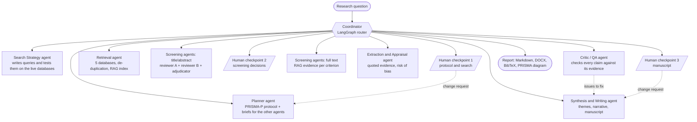

# sysrev-agents — an agentic AI pipeline for systematic reviews

A multi-agent system that takes a research question and carries out a complete systematic
literature review following PRISMA 2020: protocol, search strategy, multi-database retrieval,
de-duplication, dual screening, full-text assessment, data extraction, risk-of-bias appraisal,
synthesis, and a referenced manuscript — with every decision logged and reproducible.

Built with **LangGraph / LangChain** (orchestration, tool calling, checkpointing, human-in-the-loop)
and a **hybrid RAG pipeline** (dense + BM25 retrieval, cross-encoder re-ranking, contextual
compression) over the retrieved literature.

| | |
|---|---|
| Demonstration review | [`examples/demo_run/report.md`](examples/demo_run/report.md) ([Word version](examples/demo_run/report.docx)) |
| Technical report | [`docs/TECHNICAL_REPORT.md`](docs/TECHNICAL_REPORT.md) |
| Evaluation results | [`docs/evaluation/`](docs/evaluation/) |
| Protocol template | [`config/protocol_template.yaml`](config/protocol_template.yaml) |

---

## 1. How it works



Every stage returns to the coordinator, which picks the next unfinished stage. There are three
loops: the human can send the protocol back to the planner, the critic can send the manuscript back
to the writer, and the human can request a final revision.

### The agents

| Agent | Code | What it does | Default model |
|---|---|---|---|
| Coordinator / Planner | [`graph.py`](src/sysrev/graph.py), [`agents/planner.py`](src/sysrev/agents/planner.py) | Routes the workflow; writes the protocol from the template; writes a topic-specific brief for each other agent | gpt-oss-120b |
| Search Strategy | [`agents/search_strategy.py`](src/sysrev/agents/search_strategy.py) | Concept blocks (synonyms, MeSH); one query per database in its own syntax; calls the `test_query` tool to count hits and refines | gpt-oss-120b |
| Retrieval | [`agents/retrieval.py`](src/sysrev/agents/retrieval.py) | Runs the searches, de-duplicates, applies date limits, builds the index, ranks records when there are more than the screening budget, fetches open-access full texts | no LLM |
| Screening (two stages) | [`agents/screening.py`](src/sysrev/agents/screening.py) | Two independent reviewers on two different models, an adjudicator for conflicts, a rationale and criterion id for every decision, Cohen's kappa | gpt-oss-20b (A), qwen3.8-27b (B), gpt-oss-120b (adjudicator) |
| Extraction and Appraisal | [`agents/extraction.py`](src/sysrev/agents/extraction.py) | Structured extraction with a verbatim quotation per value, verified in code against the source; risk of bias with the tool matching the design | gpt-oss-120b (extraction), gpt-oss-20b (appraisal) |
| Synthesis and Writing | [`agents/synthesis.py`](src/sysrev/agents/synthesis.py) | Themes, narrative synthesis with citations, certainty ratings, meta-analysis preparation, evidence map, full PRISMA-structured manuscript | gpt-oss-120b |
| Critic / QA | [`agents/critic.py`](src/sysrev/agents/critic.py) | Rule-based checks (PRISMA flow arithmetic, checklist, citations, quotations) and LLM audits on a different model (faithfulness, overstatement, re-screening of excluded records, eligibility of included studies) | qwen3.8-27b |

Which model does which task is configuration (`ROLE_*` variables, see section 4).

### RAG pipeline

[`rag/index.py`](src/sysrev/rag/index.py): abstracts and open-access full texts are chunked
(section-aware), embedded locally (`BAAI/bge-small-en-v1.5`, ONNX) into **Chroma**, and indexed with
**BM25**. A query runs both retrievers, fuses the rankings (reciprocal rank fusion), re-ranks with a
cross-encoder (FlashRank, `ms-marco-MiniLM-L-12-v2`), and compresses the passages to the sentences
closest to the query. It is used to: rank records before screening, find the passages relevant to
each eligibility criterion, find the passages for each data item, ground the introduction and the
thematic synthesis, and give the critic the same evidence as the writer.

### Transparency and reproducibility

Each run has its own directory (`runs/<run_id>/`):

| File | Content |
|---|---|
| `manifest.json` | question, options, model per task, package versions |
| `audit.jsonl` | one line per agent action, tool call, routing decision and human decision |
| `llm_trace.jsonl` | every model call: full prompt, response, tokens, latency, cache hit |
| `protocol_v1.json`, `protocol_v2.json`… | every artifact is versioned, never overwritten |
| `search_strategy_v*.json` | concept blocks, final queries, hit counts, every query tested |
| `records_raw.jsonl`, `records.jsonl`, `dedup_log.jsonl` | records before and after de-duplication, with merge reasons |
| `screening_title_abstract.jsonl`, `screening_full_text.jsonl` | both reviewers' votes and rationales, adjudication, final decision |
| `extractions.jsonl`, `evidence_table.csv`, `risk_of_bias.jsonl`, `effects.csv` | extracted data with quotations and their verification status |
| `qa_report.md` | the critic's checks and issues |
| `report.md`, `report.docx`, `references.bib`, `prisma_flow.png`, `evidence_map.png` | final outputs |
| `checkpoints.sqlite` | LangGraph state after every node (resume after a pause or a crash) |

Model calls use temperature 0 and are cached on disk: re-running the same step with the same inputs
replays the same answers at no cost.

---

## 2. Installation

Requirements: Python 3.11–3.13 and about 1.5 GB of disk (dependencies and two small local models).

```bash
git clone <repository-url>
cd <repository-folder>

# with uv (recommended)
uv venv --python 3.12
source .venv/bin/activate
uv pip install -e ".[dev]"

# or with pip
python3.12 -m venv .venv
source .venv/bin/activate
pip install -e ".[dev]"
```

`requirements-lock.txt` lists the exact versions the project was developed and tested with; if a
newer release of a dependency breaks something, install from it first
(`uv pip install -r requirements-lock.txt`, then `uv pip install -e . --no-deps`).

All commands below assume the virtual environment is activated.

The first run downloads the embedding model (about 65 MB) and the re-ranker (about 35 MB) into
`.cache/`.

## 3. Configuration

```bash
cp .env.example .env
```

Then put your key in `.env`:

```
GROQ_API_KEY=gsk_...
```

A free key is created at <https://console.groq.com> (API Keys → Create API Key). `.env` is listed in
`.gitignore`; never commit it.

No other key is needed: PubMed, Europe PMC, OpenAlex, arXiv and Semantic Scholar are used through
their public APIs. Optional keys (`OPENALEX_API_KEY`, `S2_API_KEY`, `NCBI_API_KEY`) only raise rate
limits. Your e-mail address is sent to those services only if you set `CONTACT_EMAIL`.

### Free-tier quotas

The Groq free tier allows, per model, 8,000 tokens per minute and **200,000 tokens per day**. The
pipeline is built around that constraint: a token-aware rate limiter, an on-disk cache, compact
prompts, and tasks spread over three models. With the default options (50 records screened) a
review fits in one day of free quota and takes roughly an hour, nearly all of it waiting for the
rate limiter. Check your usage at any time:

```bash
sysrev quota
```

If the daily quota runs out, the run stops with a clear message and nothing is lost: run
`sysrev resume <run_id>` later (the quota regenerates continuously, about 8,000 tokens per hour
per model). If it runs out during a revision round, the run finishes with the reviewed draft and
`sysrev revise <run_id>` applies the revision afterwards. Setting `LLM_MAX_WAIT_SECONDS=3600` lets
an unattended run wait for the quota instead of stopping. On a paid plan, raise
`TOKENS_PER_MINUTE` in `.env` and the `--max-per-source` / `--max-screen` options.

## 4. Usage

### Command line

```bash
# interactive review: stops at three checkpoints for your approval
sysrev run "Does remote monitoring reduce readmissions in adults with heart failure?"

# fully autonomous review
sysrev run "your question" --auto

# options
sysrev run "your question" --max-per-source 60 --max-screen 50 \
    --databases pubmed,europepmc,openalex --fulltext-fallback abstract --qa-rounds 2

sysrev list                 # runs on disk
sysrev status <run_id>      # progress and headline numbers
sysrev resume <run_id>      # continue after a checkpoint, a crash or a quota stop
sysrev revise <run_id>      # send a finished run back to the writer with the critic's open issues
sysrev rebuild <run_id>     # regenerate the report and exports without new model calls
sysrev export <run_id> examples/my_review   # copy the shareable artifacts of a run
sysrev evaluate <run_id>    # evaluation report of a finished run
sysrev quota                # tokens and requests used over the last 24 hours
sysrev benchmark            # list benchmark datasets
sysrev benchmark --dataset Appenzeller-Herzog_2020 --n 60   # screening vs human labels
```

| Option | Default | Meaning |
|---|---|---|
| `--auto` | off | auto-approve the three human checkpoints (recorded as such in the report) |
| `--max-per-source` | 60 | records fetched per database, most relevant first |
| `--max-screen` | 50 | records sent to screening; if more are retrieved, the most relevant are kept and the others are counted in the PRISMA diagram as removed by automation |
| `--databases` | chosen by the planner | override: `pubmed,europepmc,openalex,arxiv,semantic_scholar` |
| `--fulltext-fallback` | `abstract` | when no open-access full text exists: assess on the abstract (flagged), or `exclude` as not retrieved |
| `--qa-rounds` | 2 | maximum critic → writer revision rounds |
| `--template` | `config/protocol_template.yaml` | protocol template |

### Human checkpoints

| Checkpoint | You see | You can |
|---|---|---|
| 1. Protocol and search | protocol, queries, hit counts | approve; describe changes (the planner revises, the search is redone); edit the protocol yourself |
| 2. Screening | every title/abstract decision with both votes and rationales, kappa | approve; override any decision |
| 3. Manuscript | the draft and the critic's report | approve; request a revision |

Human decisions are logged and reported in the Methods section of the manuscript. A run stopped at
a checkpoint can be closed and resumed later.

### Web interface

```bash
streamlit run app/streamlit_app.py
```

Start a review, answer the checkpoints in forms (the screening table is editable), and browse
everything: protocol, queries, PRISMA diagram, screening decisions, extracted data with their
quotations, the manuscript, the critic's report and the audit trail.

To browse the demonstration review without running anything or setting a key:

```bash
RUNS_DIR=examples streamlit run app/streamlit_app.py
```

### Protocol template

[`config/protocol_template.yaml`](config/protocol_template.yaml) is aligned with PRISMA-P. Values
under `fixed` are imposed on the planner (framework, date range, languages, databases, study
designs, mandatory criteria and data items); text under `guidance` tells it how to write each
field; `administrative` holds the registration, funding and competing-interest statements printed
in the manuscript.

### Choosing models

In `.env`:

```
LLM_PROVIDER=groq                 # groq | ollama | anthropic | openai
MODEL_PRIMARY=openai/gpt-oss-120b
MODEL_SECONDARY=qwen/qwen3.8-27b
MODEL_FAST=openai/gpt-oss-20b
ROLE_EXTRACTOR=primary            # any task can be moved: ROLE_PLANNER, ROLE_SEARCH, ROLE_REVIEWER_A,
ROLE_CRITIC=secondary             # ROLE_REVIEWER_B, ROLE_ADJUDICATOR, ROLE_EXTRACTOR, ROLE_APPRAISER,
                                  # ROLE_WRITER, ROLE_CRITIC, ROLE_AUDITOR, ROLE_UTILITY
```

Keep reviewer A and reviewer B on different models, and the critic on a different model from the
writer. For `anthropic` or `openai`, also install `langchain-anthropic` or `langchain-openai`.

---

## 5. Demonstration

Question: *How accurate are large language models at title and abstract screening for systematic
reviews, compared with human reviewers?* Run in autonomous mode on the Groq free tier.

```bash
ROLE_EXTRACTOR=fast sysrev run "How accurate are large language models at title and abstract screening for systematic reviews, compared with human reviewers?" \
    --auto --max-per-source 40 --max-screen 24 --qa-rounds 1
```

| Stage | Result |
|---|---|
| Protocol | PICO question, 5 inclusion and 5 exclusion criteria, 7 data items; the planner chose PubMed, Europe PMC and Semantic Scholar |
| Search strategy | 2 concept blocks, 5 queries tested on the live databases; final hits: PubMed 195, Europe PMC 312, Semantic Scholar 221 |
| Retrieval | 120 records (40 per database), 8 duplicates merged, 112 unique; the 24 most relevant were screened, 88 reported as removed by automation |
| Title/abstract screening | 20 retained, 4 excluded; Cohen's kappa between the two reviewers 0.83; 1 conflict adjudicated |
| Full-text screening | 10 open-access full texts retrieved and indexed, 10 reports assessed on the abstract; 13 included, 7 excluded with reasons; kappa 0.66; 3 conflicts adjudicated |
| Extraction and appraisal | 13 studies; 98 of 109 supporting quotations found in the source (90%); tools chosen: QUADAS-2 (8), PROBAST (2), ROBINS-I (2), JBI (1); 12 studies "some concerns", 1 "unclear" |
| Synthesis | 4 themes, certainty rating per theme, 8,700-word manuscript, 17 references, 5 tables, PRISMA diagram and evidence map; 42 of 42 PRISMA items reported |
| Critic | 8 issues: 3 unsupported statements, 2 overstatements in the abstract, 2 narratives with too few citations, 1 excluded record an independent auditor would include |
| Cost | 34.9 minutes, 148 model calls, 228 audit events |

Outputs in [`examples/demo_run/`](examples/demo_run/): [`report.md`](examples/demo_run/report.md),
[`report.docx`](examples/demo_run/report.docx), [`prisma_flow.png`](examples/demo_run/prisma_flow.png),
[`qa_report.md`](examples/demo_run/qa_report.md), [`evaluation.md`](examples/demo_run/evaluation.md),
[`audit.jsonl`](examples/demo_run/audit.jsonl), and every intermediate artifact.


What to know when reading this demonstration:

- **It is small.** The free daily quota was shared with development runs, so only 24 records were
  screened. The numbers describe that sample of the literature, not the whole field.
- **The critic's issues are not yet corrected.** The daily quota of the writing model ran out just
  before the revision round. The pipeline finished with the first draft, recorded that the revision
  was skipped, and says so in the manuscript (Methods 2.9 and Limitations 4.3). To apply the
  revision once quota is available: `sysrev revise <run_id>`, then
  `sysrev export <run_id> examples/demo_run`.
- **Extraction ran on the smaller model** (`ROLE_EXTRACTOR=fast`) for the same quota reason; the
  default is the larger one.
- **No human verified anything** (autonomous mode). The manuscript is a draft for expert review.

## 6. Evaluation

The four measures asked for — completeness, accuracy, inter-agent consistency, time savings —
are computed by `sysrev evaluate` from the run artifacts. For the demonstration review
([full report](examples/demo_run/evaluation.md)):

| Measure | Result |
|---|---|
| **Completeness** | 42/42 PRISMA 2020 items reported; PRISMA flow arithmetic consistent; 13/13 included studies extracted and appraised; 61 of 89 data items reported by the studies; 8 of 13 studies read from full text |
| **Accuracy and grounding** | 98/109 extraction quotations located in the source text (90%); 0 citations to non-existent records; 0 of 13 included studies flagged by the eligibility audit; 3 unsupported statements and 2 overstatements detected by the critic in the first draft (not yet corrected, see section 5) |
| **Inter-agent consistency** | title/abstract: kappa 0.83, raw agreement 96%, 1 conflict in 24; full text: kappa 0.66, raw agreement 85%, 3 conflicts in 20; independent re-screening of the 4 excluded records agreed on 3 |
| **Time** | 0.58 hours of machine time, against an estimated 67.7 person-hours for a manual review of the same workload (24 records, 20 full texts, 13 studies) |

The manual figure is an estimate, not a measurement: it applies per-task assumptions that are
written down in [`config/manual_effort.yaml`](config/manual_effort.yaml) and can be changed.
Restricted to the per-item tasks (screening, full-text assessment, extraction, appraisal), the
estimate is 22.7 person-hours against 0.41 hours. Machine time excludes the time a human needs to
check the output, which a real review still requires. For context, published reviews registered in
PROSPERO took 67 weeks on average from registration to publication (Borah et al., 2017).

### Screening accuracy against human reviewers

`sysrev benchmark` screens a sample of records that human reviewers already labelled, using the
same agents as a real review. The agents receive only the title and abstract of the published
review; they never see a label.

Dataset: Appenzeller-Herzog 2020 (therapies for Wilson disease), 2,358 records with an abstract,
161 kept by the humans at title/abstract stage. Stratified sample of 60 records, 21 of them
human-kept ([full report](docs/evaluation/benchmark_screening_prompt_v1_seed13_n60.md)).

| Screener (prompt v1) | Sensitivity | Specificity | Kappa vs humans |
|---|---|---|---|
| Pipeline: reviewer A + reviewer B + adjudicator | 0.14 (3/21) | 1.00 (39/39) | 0.18 |
| Reviewer A alone (gpt-oss-20b) | 0.19 | 1.00 | 0.23 |
| Reviewer B alone (qwen3.8-27b) | 0.19 | 1.00 | 0.23 |

- The two AI reviewers agreed with each other (kappa 0.73) and never kept a record the humans had
  excluded.
- All 3 studies of the sample that the published review finally included were kept by the pipeline.
- But the pipeline excluded 18 of the 21 records the humans had carried to full-text review. In 16
  of these 18 the stated reason is the same: a cohort description or case series whose abstract
  "does not mention a comparator". Human screeners keep such records and check the full text.

This result changed the system. The title/abstract prompt (v2, `agents/screening.py`) now states
that only positive evidence of ineligibility excludes a record and that information missing from an
abstract sends the record to full-text review. In the demonstration, run with v2, the reviewers
kept 20 of 24 records at title/abstract stage and the decision was made on the full text.

**Prompt v2 has not yet been measured on labelled data**: the daily quota was exhausted. The
sample above served to diagnose the problem, so v2 must be tested on a different sample:

```bash
sysrev benchmark --dataset Appenzeller-Herzog_2020 --n 60 --seed 7
```

## 7. Tests

```bash
pytest
```

32 tests, no network and no API key needed:

- `tests/test_tools.py` — de-duplication, Cohen's kappa, classification metrics, random-effects
  pooling (checked against hand calculations), PRISMA flow arithmetic and checklist validator,
  citation numbering, quotation verification, risk-of-bias rule, rate limiter, exports.
- `tests/test_graph.py` — the real LangGraph workflow with the LLM agents replaced by fakes:
  routing, the three human checkpoints, the protocol-revision loop, the critic → writer loop,
  checkpointing and resumption in a fresh process.

## 8. Project structure

```
config/
  protocol_template.yaml     configurable PRISMA-P protocol template
  manual_effort.yaml         assumptions used to estimate manual review time
src/sysrev/
  graph.py                   LangGraph workflow, coordinator, human checkpoints, runner
  context.py                 per-run context, run options, manifest
  llm.py                     model factory, rate limiter, cache, structured output, tracing
  audit.py                   audit log, versioned artifact store, stage timer
  models.py                  typed data model (records, protocol, decisions, extractions…)
  agents/                    planner, search_strategy, retrieval, screening, extraction, synthesis, critic
  sources/                   PubMed, Europe PMC, OpenAlex, arXiv, Semantic Scholar, full-text retrieval
  rag/index.py               hybrid index: Chroma + BM25, fusion, re-ranking, compression
  tools/                     de-duplication, statistics, PRISMA helpers, exports
  evaluation/                run metrics and the screening benchmark
  cli.py                     command-line interface
app/streamlit_app.py         web interface
tests/                       unit and workflow tests
examples/demo_run/           artifacts of the demonstration review
docs/                        technical report, evaluation results, video script
```

## 9. Development steps

1. **Environment** — Python 3.12 virtual environment with `uv`; dependencies declared in
   `pyproject.toml`.
2. **LLM layer** — Groq free tier measured (8,000 tokens/min, 200,000 tokens/day per model); built a
   token-aware rate limiter, an on-disk cache, validated structured output with self-repair, and
   full call tracing. When the daily limit turned out to be the real constraint: compact schema
   prompts, a configurable task-to-model mapping, a usage ledger (`sysrev quota`) and clean stops.
3. **Literature connectors** — five databases behind one interface (`count`, `search`), each tested
   against the live API; open-access full text from Europe PMC (JATS XML), arXiv and publisher PDFs.
4. **Deterministic tools** — de-duplication, statistics, PRISMA flow and checklist, exports; unit
   tests written alongside.
5. **RAG index** — Chroma + BM25, rank fusion, re-ranking, compression; then section-aware chunks and
   row-wise table rendering after the first run showed that result tables were being missed.
6. **Agents** — planner, search strategy (tool-calling loop), retrieval, screening, extraction and
   appraisal, synthesis and writing, critic.
7. **Orchestration** — LangGraph state graph with a coordinator, SQLite checkpointing, three
   interrupt-based human checkpoints, two revision loops; workflow tests with fake agents.
8. **Interfaces** — Typer CLI and Streamlit application.
9. **Trial runs and fixes** — a small end-to-end run exposed real defects, each fixed and covered by
   a test where possible: PubMed identifiers taken from reference lists, OpenAlex full-text search
   far too broad, unreliable "review" labels misleading the screeners, LaTeX residue in full texts,
   author names in three different formats, citations written with non-standard brackets.
10. **Evaluation** — screening benchmark against human decisions, which showed that the first
    screening prompt was too strict; the prompt was revised (section 6).
11. **Demonstration** — full autonomous review on a real question (section 5).

## 10. Limitations

- Language models screen, extract and appraise. Dual screening with different models reduces but
  does not remove shared errors; a human should verify decisions before the review is used.
- Only databases with free APIs are searched (no Embase, Scopus, Web of Science, trial registers,
  grey literature), and only open-access full texts are read; other reports are assessed on their
  abstract and flagged.
- On the free tier the number of records screened per day is limited; records beyond the cap are
  dropped by relevance ranking and reported as such.
- Meta-analysis is exploratory: comparability of effect estimates is judged by a model.
- Risk-of-bias and certainty ratings are produced by one automated assessor and are indicative.

## 11. Team and individual contributions

| Member | Contribution |
|---|---|
| _to be completed_ | _to be completed_ |

## 12. References

- Page MJ, et al. The PRISMA 2020 statement: an updated guideline for reporting systematic reviews.
  BMJ. 2021;372:n71.
- Moher D, et al. Preferred reporting items for systematic review and meta-analysis protocols
  (PRISMA-P) 2015 statement. Syst Rev. 2015;4:1.
- Borah R, Brown AW, Capers PL, Kaiser KA. Analysis of the time and workers needed to conduct
  systematic reviews of medical interventions using data from the PROSPERO registry. BMJ Open.
  2017;7:e012545.
- De Bruin J, et al. SYNERGY — open machine learning dataset on study selection in systematic
  reviews. DataverseNL; 2023. https://github.com/asreview/synergy-dataset
- LangGraph and LangChain documentation: https://langchain-ai.github.io/langgraph/
