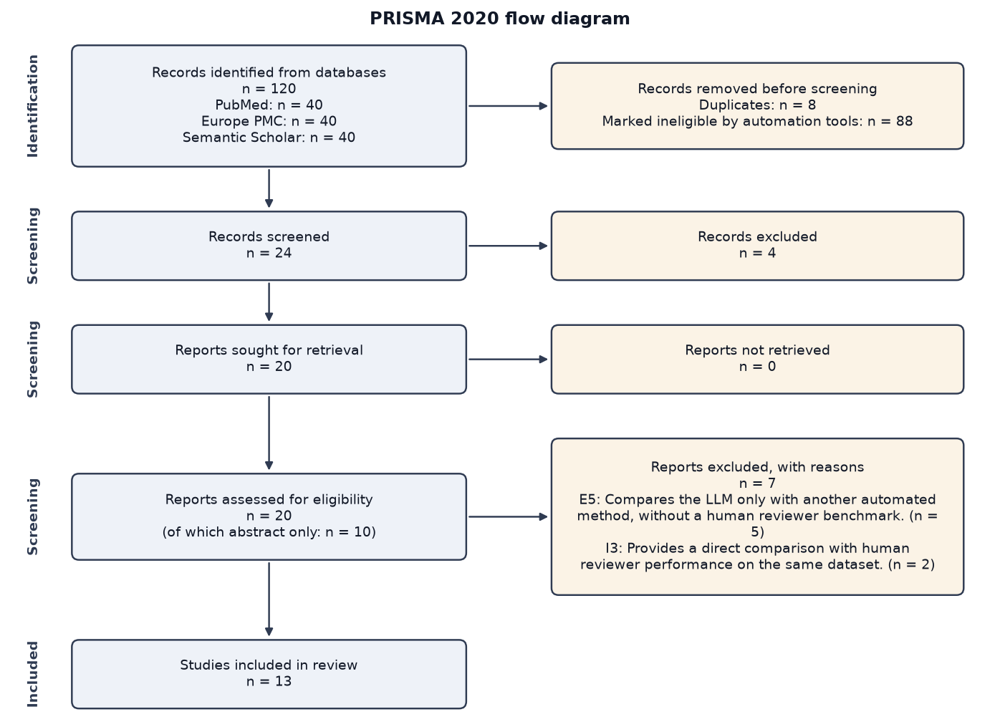
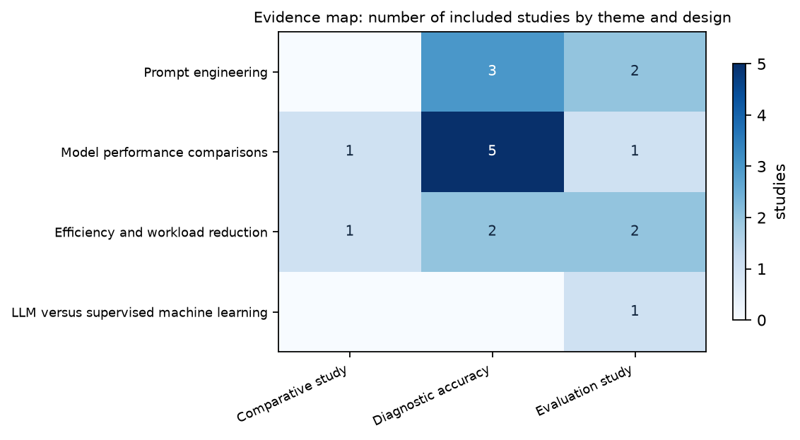

# Systematic Review of the Accuracy of Large Language Models for Title and Abstract Screening in Systematic Reviews

## Abstract

**Background:** Large language models (LLMs) are increasingly applied to title and abstract screening in systematic reviews, yet their accuracy relative to human reviewers remains unclear.

**Objectives:** To identify primary studies evaluating LLM performance for title/abstract screening, to compare reported accuracy metrics of LLMs with human reviewers, to assess methodological quality, and to examine the feasibility of meta‑analysis of accuracy outcomes.

**Methods:** We searched PubMed, Europe PMC and Semantic Scholar on 2026-11-10. Of 120 records identified, 24 were screened on title and abstract by two independent AI reviewers with adjudication of disagreements, 20 reports were assessed for eligibility and 13 studies were included. Data were extracted with supporting quotations that were verified automatically against the source, risk of bias was appraised with design-specific tools, and findings were synthesised narratively by theme.

**Results:** All 13 studies had some concerns (12) or unclear (1) risk of bias. Optimised prompts markedly improved sensitivity (e.g., 97.7% with GPT‑4‑0125‑preview) but often reduced precision (4–20%). Reported sensitivities ranged from 0.75 to 1.00 and specificities from 0.80 to 0.98. Direct model comparisons showed heterogeneous accuracy: human reviewers achieved 0.9593, Claude 0.9448, ChatGPT 0.9138; other models varied in sensitivity versus specificity trade‑offs. Larger datasets (e.g., n=15,605) yielded lower accuracy (~85 %) than smaller, abstract‑only reports. Five studies demonstrated workload reductions of 60–75 %, saving 10–15 minutes per 100 records and achieving screening speeds of 1/4 to 1/3 of human time. A zero‑shot Llama‑3.1‑8B‑Instruct LLM attained recall 0.86, comparable to humans, but lower specificity (0.79) than traditional supervised‑machine‑learning classifiers.

**Conclusions:** LLMs can achieve very high sensitivity for systematic review screening when prompts are carefully engineered, though precision varies. Performance is model‑ and dataset‑dependent, and larger, real‑world datasets tend to show modest accuracy. LLMs consistently reduce screening time, but methodological limitations and heterogeneity yield low to moderate certainty evidence. Further high‑quality, standardized evaluations are needed before routine replacement of human screening.

## 1. Introduction

### 1.1 Rationale

Large language models (LLMs) have emerged as a potential solution to the labor‑intensive title‑and‑abstract screening stage that delays systematic reviews, yet their reliability compared with expert human reviewers remains unclear [1]. Early investigations report promising accuracy for GPT‑4o and related models, but also highlight the need for higher precision to meet the standards required for clinical and policy‑making evidence [2, 3]. Empirical evaluations across diverse domains—including radiology, venture‑capital evidence synthesis, and general biomedical literature—show that LLMs can achieve sensitivities and specificities approaching those of human reviewers, but performance varies with prompt design, model size, and the presence of disagreement, underscoring the importance of careful human‑in‑the‑loop oversight [4, 5, 6]. Comparative work suggests that zero‑shot, criteria‑prompted LLMs can match or exceed supervised machine‑learning baselines, yet the evidence is fragmented, with most studies focusing on single model families or specific review topics, and limited data on ensemble approaches or broader applicability [7, 8]. Consequently, a systematic synthesis of existing empirical assessments is needed to clarify the accuracy of LLM‑driven screening, identify conditions under which they can reliably augment or replace human judgment, and guide methodological recommendations for future systematic review workflows.

### 1.2 Objectives

This review addresses the question: *How accurate are large language models at title and abstract screening for systematic reviews, compared with human reviewers?* Specific objectives:
- To identify and summarise primary studies that evaluate the performance of LLMs for title and abstract screening in systematic reviews.
- To compare reported accuracy metrics of LLMs with those of human reviewers.
- To assess the methodological quality of the identified studies.
- To determine whether meta‑analysis of accuracy outcomes is feasible.

## 2. Methods

This review is reported according to the PRISMA 2020 statement. It was conducted by a multi-agent AI pipeline whose every decision is logged; the completed PRISMA checklist is in Appendix C.

### 2.1 Eligibility criteria

The review question was structured with the PICO framework: **Population**: Records (titles and abstracts) that are candidates for inclusion in systematic reviews.; **Intervention**: Screening performed by a large language model (e.g., GPT‑4, Claude, LLaMA).; **Comparator**: Screening performed by human reviewers (single or duplicate).; **Outcome**: Accuracy measures (sensitivity, specificity, precision, recall, F1‑score) and screening efficiency (time per record)..

Inclusion criteria:
- I1. Primary research evaluating a large language model for title and/or abstract screening of systematic reviews.
- I2. Reports at least one quantitative accuracy metric (e.g., sensitivity, specificity, precision, recall, F1‑score) for the LLM.
- I3. Provides a direct comparison with human reviewer performance on the same dataset.
- I4. Written in English.
- I5. Full‑text available (including preprints and conference papers).

Exclusion criteria:
- E1. Not a primary research report (editorials, commentaries, letters, protocols, narrative or systematic reviews).
- E2. Evaluates only generic NLP tools that are not classified as large language models (e.g., keyword filters, traditional machine‑learning classifiers).
- E3. Focuses solely on full‑text screening or data extraction without assessing title/abstract screening.
- E4. Does not report any performance metric for the LLM.
- E5. Compares the LLM only with another automated method, without a human reviewer benchmark.

Eligible study designs: Diagnostic accuracy study, Cross‑sectional validation study, Randomised controlled trial of screening methods, Non‑randomised comparative study. No publication-date limit was applied. Languages: English.

### 2.2 Information sources

The following bibliographic databases were searched on 2026-11-10 through their public APIs: PubMed (40 records retrieved), Europe PMC (40 records retrieved), Semantic Scholar (40 records retrieved). No trial registers, grey-literature sources or reference lists were searched, and no study authors were contacted.

### 2.3 Search strategy

The Search Strategy agent derived concept blocks from the protocol (*Large language models for screening*; *Title/abstract screening in systematic reviews*), wrote one query per database in its native syntax, and refined each query against the live database until the number of hits was manageable. The queries combined the LLM block with the screening block using AND, and added a third block of accuracy terms to keep results within a manageable size. PubMed required narrowing to title/abstract fields and adding outcome keywords, while Europe PMC needed all terms forced into TITLE_ABS and also benefited from the outcome block. Semantic Scholar’s flexible syntax allowed a single combined query with the three blocks, yielding a similar hit count. This balances sensitivity—capturing all relevant LLM‑screening studies—with precision by limiting to records that report performance metrics. For PubMed, Europe PMC, Semantic Scholar the query matched more records than the per-database retrieval limit (40); the most relevant records according to the database's own ranking were retrieved (total hits: PubMed 195, Europe PMC 312, Semantic Scholar 221). The full search strings are given in Appendix A.

### 2.4 Selection process

Records were de-duplicated automatically (matching on DOI, PubMed id, arXiv id, exact normalised title, then fuzzy title similarity of at least 95% with publication years at most one apart). Before screening, 88 records were removed by automation tools (relevance-ranking cap: 88). The relevance-ranking cap keeps the 24 records ranked highest against the review question by hybrid dense (sentence-embedding) and sparse (BM25) retrieval with reciprocal rank fusion. Titles and abstracts were then screened independently by two AI reviewers built on different language models (reviewer A: openai/gpt-oss-20b; reviewer B: qwen/qwen3.8-27b), each applying the eligibility criteria without access to the other's votes. Records were excluded only when both reviewers excluded them or when an adjudicator agent (openai/gpt-oss-120b), given both rationales, decided so; unclear records were carried forward. Full texts were sought for all retained records from open-access sources (Europe PMC, arXiv, publisher open-access PDFs). For each report, the passages most relevant to each eligibility criterion were retrieved from the full text (hybrid retrieval, cross-encoder re-ranking) and assessed by the same two independent reviewers, with adjudication of disagreements. When no open-access full text could be retrieved, eligibility was assessed on the abstract alone and the study is flagged accordingly. Inter-reviewer agreement was Cohen's kappa = 0.8333 (almost perfect) at title/abstract stage and 0.6591 (substantial) at full-text stage. The run was executed in autonomous mode: the human checkpoints (protocol and search strategy, screening decisions, final report) were auto-approved and no human verified the decisions.

### 2.5 Data collection process

Data were extracted by an Extraction agent (openai/gpt-oss-20b) into a structured form. For each study the agent received the abstract and the full-text passages retrieved for every data item, and had to supply a verbatim supporting quotation for every extracted value. Each quotation was then checked programmatically against the source text; values whose quotation could not be located are flagged as unverified in the evidence tables. Extraction was performed once (not in duplicate).

### 2.6 Data items

Outcomes sought: Sensitivity (recall) of LLM screening; Specificity of LLM screening; Precision (positive predictive value); F1‑score; Time per record screened; Number of records correctly included/excluded. All results compatible with each outcome were sought. Other data items: study design; country; sample size; Number of records screened; LLM name, version, and prompting strategy; Human reviewer process (single, duplicate, consensus); Reference standard definition (gold‑standard inclusion decisions); Reported accuracy metrics (sensitivity, specificity, precision, recall, F1‑score); Screening time per record for LLM and humans; Any reported adverse effects (e.g., missed critical studies); limitations reported by the authors; funding. Items that a report did not state were recorded as 'Not reported'; no assumptions were made about missing information.

### 2.7 Risk of bias assessment

QUADAS‑2 will be applied to diagnostic accuracy studies; ROBINS‑I will be used for non‑randomised comparative designs; RoB 2 will be applied if any randomised trials are found. Two reviewers will assess each study independently, with disagreements resolved by consensus. In practice, an Appraisal agent (openai/gpt-oss-20b) selected for each study the tool matching its design among RoB 2 (randomised controlled trials), ROBINS-I (non-randomised studies of interventions), QUADAS-2 (diagnostic test accuracy studies), Newcastle-Ottawa Scale (cohort and case-control studies), PROBAST (prediction-model, machine-learning and algorithm evaluation studies), JBI checklist (cross-sectional, qualitative, case-series and any other design), judged every domain as low, some concerns, high or unclear with a written justification, and the overall judgement was derived by rule (any high domain: high; otherwise any concern or unclear domain: some concerns; all domains unclear: unclear; else low). Appraisal was performed once per study by one automated assessor.

### 2.8 Effect measures

Effect measures were recorded as reported by the study authors (for example odds ratios, risk ratios, mean differences, or performance metrics such as sensitivity and specificity), with 95% confidence intervals where available. No effect measure was re-computed from raw data.

### 2.9 Synthesis methods

A narrative synthesis will summarise study characteristics, LLM configurations, and accuracy outcomes, grouped by model type and screening context. If ≥3 studies report comparable sensitivity and specificity on similar datasets, a random‑effects meta‑analysis will be performed using a bivariate model. All included studies were eligible for the narrative synthesis. Studies were tabulated by characteristics, risk of bias and individual results, then grouped into themes by the Synthesis agent (openai/gpt-oss-120b); a narrative synthesis was written per theme from the extracted data and retrieved passages. Every statement of the draft is checked against its evidence by a Critic agent running on a different model (qwen/qwen3.8-27b). It reviewed the manuscript in 1 round and raised 7 issues on the first draft. The revision round could not be run because the daily quota of the writing model was exhausted, so these issues remain unresolved in the present version and are listed in qa_report.md. For quantitative synthesis, effect estimates with confidence intervals were grouped by outcome and measure; where at least two studies reported comparable estimates they were pooled with inverse-variance weighting under a DerSimonian-Laird random-effects model (ratio measures on the log scale), with heterogeneity summarised by Cochran's Q, I² and tau². Heterogeneity was otherwise explored narratively by comparing study designs, samples and risk of bias. No sensitivity analyses were planned.

### 2.10 Reporting bias and certainty assessment

Risk of bias due to missing results (reporting bias) was not assessed formally: no funnel plots or small-study tests were produced. Certainty in the body of evidence for each theme was rated by the Synthesis agent with a GRADE-inspired approach (high, moderate, low, very low), considering risk of bias, inconsistency, indirectness and imprecision; these ratings are automated and indicative.

## 3. Results

### 3.1 Study selection

The searches retrieved 120 records (PubMed: 40, Europe PMC: 40, Semantic Scholar: 40). After removal of 8 duplicates and 88 records marked ineligible by automation tools, 24 records were screened on title and abstract and 4 were excluded. 20 reports were sought for retrieval, 0 were not retrieved, and 20 were assessed for eligibility (10 of them on the abstract only, because no open-access full text was available). 7 reports were excluded at this stage: E5: Compares the LLM only with another automated method, without a human reviewer benchmark. (n = 5); I3: Provides a direct comparison with human reviewer performance on the same dataset. (n = 2). 13 studies were included in the review (Figure 1). Reports excluded at full-text stage are listed with their reasons in Appendix B.



### 3.2 Study characteristics

Table 1 summarises the 13 included studies. The complete extraction form, with the supporting quotation for every value, is provided in evidence_table.csv.

*Table 1. Characteristics of included studies.*

| Study | Design | Country | Sample | Number of records screened | LLM name, version, and prompting strate… | Human reviewer process (single, duplica… | Reference standard definition (gold‑sta… | Source read |
|---|---|---|---|---|---|---|---|---|
| Cao et al. (2025) [5] | Diagnostic test accuracy | Not reported | 48 425 citations tested for abstract screening across 10 SR… | 48 425 citations for abstract screening; 12 690 articles for full-text screening | GPT4-0125-preview model (OpenAI) with optimized prompt templates; zero‑shot prompts also… (unverified) | Single human abstract screening | Original SR author decisions after full-text screening | abstract |
| Oami et al. (2024) [9] | prospective diagnostic study | Not reported | 5 clinical questions (CQs) with 5,634 + 3,418 + 1,038 + 4,3… | 16,571 records | GPT‑4 Turbo; post hoc command prompt modifications; majority‑vote and chain‑of‑thought st… | Not reported | Not reported | full text |
| Insuk et al. (2025) [10] | Diagnostic accuracy study | Not reported | Not reported | Not reported | ChatGPT-4o, Claude 3.5 Sonnet; structured prompt-based approach; short and long prompt st… | Junior researchers vs experienced researcher; reference standard by experienced researcher | Decisions by an experienced researcher | abstract |
| Oami et al. (2025) [11] | prospective diagnostic accuracy study | Not reported | Not reported | Not reported | GPT-4o, Gemini 1.5 Pro, Claude 3.5 Sonnet, Llama 3.3 70B | Not reported | Manual full‑text screening for qualitative assessment and title/abstract screening for se… | full text |
| Aigner et al. (2026) [7] | comparative evaluation study | Not reported | six datasets (open-source SYNERGY dataset) | Not reported | Llama-3.1-8B-Instruct, zero‑shot, criteria‑prompted | Not reported | Human reviewers’ labels from six systematic reviews | full text |
| Kwok et al. (2026) [12] | Comparative analysis | Not reported | 10,793 newly published records | 10,793 newly published records | gpt-4o, gpt-4.5, gpt-4-turbo within ChatGPT and Copilot | Not reported | Not reported | abstract |
| Sood et al. (2025) [13] | Diagnostic accuracy study | Not reported | Not reported | Not reported | Claude Sonnet 3.5, Gemini Flash 1.5, GPT-4 | Single human reviewer | Not reported | abstract |
| Fazeli et al. (2026) [3] | Diagnostic accuracy study | Not reported | 15,605 records | 15,605 records | GPT-4o mini, structured prompts | Expert human reviewers | Expert human reviewers' decisions | abstract |
| Sanghera et al. (2025) [14] | cross‑sectional validation study | Not reported | 23 Cochrane Library systematic reviews (development dataset… | 119 695 | GPT‑3.5 Turbo, GPT‑4 Turbo, GPT‑4o, Llama 3 70B, Gemini 1.5 Pro, Claude Sonnet 3.5; optim… | Not reported | Not reported | full text |
| Qiu et al. (2026) [15] | Cross‑sectional validation study | Not reported | 3 datasets (1,000 abstracts, 50 full texts; 1,321 abstracts… | 3,821 abstracts and 261 full texts | ChatGPT, prompt‑based structured approach with stepwise training, comprehension checks, c… | Not reported | Not reported | full text |
| Zhan et al. (2025) [16] | validation study | Not reported | Not reported | Not reported | Review Copilot, GPT‑4 | Not reported | Human decisions | full text |
| Li et al. (2024) [17] | Comparative diagnostic accuracy study | Not reported | Not reported | Not reported | ChatGPT v4.0, ChatGPT v3.5, Google PaLM 2, Meta Llama 2, ChatGPT v4.0 turbo, ChatGPT v3.5… | Duplicate with consensus | Human-curated inclusion decisions from systematic reviews | full text |
| Homiar et al. (2025) [2] | Diagnostic accuracy study | Not reported | 11 939 records in baseline test set; 3004 records reviewed… | 11 939 records in baseline test set; 3004 records reviewed manually after LLM filtering;… | GPT-4o with refined prompts | Not reported | Human decisions from an LSR on prodopaminergic interventions for anhedonia served as the… | full text |

### 3.3 Risk of bias in studies

Overall risk of bias was judged low in 0 studies, some concerns in 12, high in 0 and unclear in 1 (Table 2).

*Table 2. Risk of bias in included studies.*

| Study | Tool | Overall | Domain judgements | Main concern |
|---|---|---|---|---|
| Cao et al. (2025) [5] | QUADAS-2 | some concerns | Patient selection: unclear; Index test: low; Reference standard: some concerns; Flow and timing: unclear | The study provides clear information on the index test and its performance, but lacks transparency regarding patient selection, reference standard adjudication, and flow/timing of assessments, which limits confidence in… |
| Oami et al. (2024) [9] | QUADAS-2 | some concerns | Patient selection: unclear; Index test: low; Reference standard: some concerns; Flow and timing: unclear | The primary threat to validity is the lack of blinding between the index test and reference standard, which may inflate the apparent accuracy of the LLM. Additionally, incomplete reporting of patient selection and flow… |
| Insuk et al. (2025) [10] | QUADAS-2 | unclear | Patient selection: unclear; Index test: unclear; Reference standard: unclear; Flow and timing: unclear | The study lacks sufficient methodological detail to assess key QUADAS-2 domains, particularly regarding patient selection, index test implementation, reference standard adjudication, and flow/timing. This uncertainty li… |
| Oami et al. (2025) [11] | QUADAS-2 | some concerns | Patient selection: some concerns; Index test: low; Reference standard: some concerns; Flow and timing: unclear | The study’s limited patient selection and potential variability in the reference standard threaten validity, while the index test application appears robust. The lack of detailed flow and timing information further obsc… |
| Aigner et al. (2026) [7] | PROBAST | some concerns | Participants and data sources: some concerns; Predictors and model inputs: low; Outcome and reference labels: some concerns; Analysis: some concerns | The main threats to validity stem from potential selection bias of the six datasets and the subjectivity of human‑assigned labels, which may limit generalizability and introduce misclassification bias. Additionally, lim… |
| Kwok et al. (2026) [12] | ROBINS-I | some concerns | Confounding: unclear; Selection of participants: low; Classification of interventions: low; Deviations from intended interventions: unclear; Missing data: unclear; Measurement of outcomes: low; Selection of the reported result: unclear | The study’s primary threat to validity stems from the lack of information on confounding control and potential selective reporting of outcomes, which could bias the comparison of automated tools against human screening.… |
| Sood et al. (2025) [13] | QUADAS-2 | some concerns | Patient selection: unclear; Index test: some concerns; Reference standard: unclear; Flow and timing: unclear | The study lacks sufficient detail on patient selection, reference standard definition, and flow/timing, which limits confidence in the reported diagnostic accuracy of the AI models. The primary threat to validity is the… |
| Fazeli et al. (2026) [3] | PROBAST | some concerns | Participants and data sources: unclear; Predictors and model inputs: unclear; Outcome and reference labels: unclear; Analysis: some concerns | The study lacks detailed reporting on participant selection, input design, reference standards, and statistical analysis, which limits the ability to assess the validity and generalizability of the LLM’s performance. Th… |
| Sanghera et al. (2025) [14] | JBI checklist | some concerns | Sample and setting clearly described: low; Valid and reliable measurement: some concerns; Confounding identified and addressed: some concerns; Appropriate analysis: some concerns; Conclusions supported by the data: some concerns | The study’s main threats to validity stem from limited representativeness of the sample, potential optimization bias favoring certain LLMs, and reliance on human reviewers as the gold standard without independent verifi… |
| Qiu et al. (2026) [15] | ROBINS-I | some concerns | Confounding: unclear; Selection of participants: some concerns; Classification of interventions: low; Deviations from intended interventions: unclear; Missing data: some concerns; Measurement of outcomes: low; Selection of the reported result: some concerns | The primary threats to validity stem from unclear handling of confounding factors and potential selection bias in the datasets used for evaluation. Additionally, missing information on how missing data and deviations we… |
| Zhan et al. (2025) [16] | QUADAS-2 | some concerns | Patient selection: unclear; Index test: unclear; Reference standard: some concerns; Flow and timing: unclear | The validation relies on a very small number of systematic reviews (N=4) and lacks detailed reporting on how studies were selected, how the AI and human decisions were performed, and how the reference standard was estab… |
| Li et al. (2024) [17] | QUADAS-2 | some concerns | Patient selection: unclear; Index test: some concerns; Reference standard: some concerns; Flow and timing: unclear | The primary threats to validity stem from the limited description of how abstracts were selected and processed, potential inconsistencies in LLM prompt application, and reliance on possibly imperfect human-curated label… |
| Homiar et al. (2025) [2] | QUADAS-2 | some concerns | Patient selection: some concerns; Index test: some concerns; Reference standard: low; Flow and timing: some concerns | The principal threats to validity stem from unclear patient selection and potential lack of blinding for the index test, which may bias the performance estimates. Additionally, variability in abstract length and the abs… |

### 3.4 Results of individual studies

*Table 3. Results of individual studies.*

| Study | Key findings | Effect estimates |
|---|---|---|
| Cao et al. (2025) [5] | Optimized GPT4-0125-preview prompts achieved a weighted sensitivity of 97.7% and specificity of 85.2% for abstract screening across 10 systematic reviews. For full-text screening, the same prompts yielded a weighted sensitivity of 96.5% and specificity of 91.2%. Zero‑shot prompting performed poorly, with sensitivities of only 49.0% for abstracts and 49.1% for full-text. LLM-based screening completed 10 000 citations in under one day and cost $157.02, compared with over 83 hours and $1 666.67 for single human abstract screening. | Sensitivity of LLM abstract screening: accuracy = 97.7 (95% CI 86.7 to 100.0) (unverified); Specificity of LLM abstract screening: accuracy = 85.2 (95% CI 68.3 to 95.9) (unverified); Sensitivity of LLM full-text screening: accuracy = 96.5 (95% CI 89.7 to 100.0) (unverified); Specificity of LLM full-text screening: accuracy = 91.2 (95% CI 80.7 to 100.0) (unverified) |
| Oami et al. (2024) [9] | The LLM-assisted screening achieved an integrated sensitivity of 0.75 and specificity of 0.99 compared with conventional screening. Post hoc prompt modifications increased sensitivity to 0.91 while maintaining specificity at 0.98. LLM screening reduced processing time for 100 studies from 17.2 minutes to 1.30 minutes, a mean difference of −15.25 minutes. | Sensitivity: accuracy = 0.75 (95% CI 0.43 to 0.92); Specificity: accuracy = 0.99 (95% CI 0.99 to 0.99); Sensitivity (post hoc): accuracy = 0.91 (95% CI 0.77 to 0.97); Specificity (post hoc): accuracy = 0.98 (95% CI 0.96 to 0.99); Processing time for 100 studies: time per record = 1.3 (95% CI 1.28 to 1.32), n=100 |
| Insuk et al. (2025) [10] | In the title/abstract screening phase, human researchers demonstrated the highest accuracy (0.9593), followed by Claude (0.9448) and ChatGPT (0.9138). The F1-score was the highest among human researchers (0.3853), followed by Claude (0.3724) and ChatGPT (0.2755). Negative predictive value (NPV) was high across all screeners: ChatGPT (0.9959), Claude (0.9961), and human researchers (0.9924). In the full-text screening phase, ChatGPT with a short prompt achieved the highest accuracy (0.904), highest F1-score (0.90), and NPV of 1.00, surpassing the performance of Claude and human researchers. | Accuracy title/abstract screening: accuracy = 0.9593; Accuracy title/abstract screening: accuracy = 0.9448; Accuracy title/abstract screening: accuracy = 0.9138; F1-score title/abstract screening: F1-score = 0.3853; F1-score title/abstract screening: F1-score = 0.3724; F1-score title/abstract screening: F1-score = 0.2755 |
| Oami et al. (2025) [11] | The integrated sensitivity and specificity values for the five CQs using GPT-4o were 0.75 [0.54–0.88] and 0.98 [0.96–0.99] respectively. Gemini 1.5 Pro achieved a sensitivity of 0.93 [0.88–0.96] and specificity of 0.86 [0.80–0.90]. Claude 3.5 Sonnet achieved a sensitivity of 0.95 [0.91–0.97] and specificity of 0.81 [0.78–0.84]. Llama 3.3 70B achieved a sensitivity of 0.89 [0.68–0.97] and specificity of 0.94 [0.88–0.97]. | Sensitivity: accuracy = 0.75 (95% CI 0.54 to 0.88); Specificity: accuracy = 0.98 (95% CI 0.96 to 0.99); Processing time for 100 studies: time per 100 studies = 0.93 (95% CI 0.92 to 0.98); Cost for 100 studies: cost = 0.41 (95% CI 0.34 to 0.48) |
| Aigner et al. (2026) [7] | The Llama‑3.1‑8B‑Instruct model achieved recall values close to or above those of human reviewers. Supervised machine learning models (logistic regression, random forest, support vector machine) exceeded human specificity while falling behind human recall. Naïve Bayes performed worse in recall but exceeded human recall on average. All models’ performance varied greatly across the six datasets. | Recall: accuracy = 0.86; Specificity: accuracy = 0.79 |
| Kwok et al. (2026) [12] | Commercial web-based LLMs (ChatGPT and Copilot) achieved comparable accuracy (83%–86%) and precision (44%–48%) to each other for title and abstract screening of physiotherapy trials. Recall was high for both tools (88%–87%) and F1 scores were 59%–62%, indicating balanced performance. Using commercial tools reduced total screening time to 37% of the time required by human reviewers. Local API-based LLM implementation had similar performance (accuracy 82%, precision 42%, recall 93%, F1 58%). | Accuracy: proportion = 0.83; Accuracy: proportion = 0.86; Precision: proportion = 0.44; Precision: proportion = 0.48; Recall: proportion = 0.88; Recall: proportion = 0.87 |
| Sood et al. (2025) [13] | Gemini Flash 1.5 achieved the highest accuracy at 96.02% for title and abstract screening. GPT-4 had the highest sensitivity at 95.97%, outperforming Gemini Flash 1.5 (94.63%) and Claude Sonnet 3.5 (88.59%). All three LLMs showed high concordance with the human reviewer, with GPT-4 at 88.77% agreement. | None reported |
| Fazeli et al. (2026) [3] | The GPT-4o mini screened 15,605 records with an overall accuracy of 85.1%. Sensitivity was 83.2% and specificity 85.2%, indicating high detection of relevant studies. Positive predictive value was low at 19.8%, but negative predictive value was very high at 99.1%. The LLM processed 1,000 records in 40 minutes versus 16 hours for human reviewers, demonstrating substantial efficiency gains. | None reported |
| Sanghera et al. (2025) [14] | LLMs achieved perfect sensitivity (1.000) on the balanced development dataset while maintaining precision up to 0.927, outperforming human reviewers (sensitivity 0.775, precision 0.911). On the large comprehensive dataset (119 695 records), LLMs retained high sensitivity (0.756–1.000) but precision dropped markedly (0.004–0.096) due to class imbalance. Ensembles of LLMs and human reviewers achieved perfect sensitivity with maximal precision of 0.458 on the development dataset, decreasing to 0.145 on the comprehensive dataset, while reducing workload by 37.55% to 99.11%. Human reviewers’ sensitivity was 1.000 and specificity 0.993 on the comprehensive dataset, with precision 0.235 and F1‑score 0.381. | Sensitivity: accuracy = 1.0, n=800; Precision: accuracy = 0.927, n=800; Specificity: accuracy = 0.993, n=119695 (unverified); F1‑score: accuracy = 0.381, n=119695 (unverified); Workload reduction: proportion = 0.9911 |
| Qiu et al. (2026) [15] | The LLM achieved 98 % sensitivity and 80.6 % specificity at abstract screening in Study 1. In Study 2, the LLM reached 100 % sensitivity and 85.6 % specificity for abstracts, and 82.1 % accuracy for full‑text screening. Study 3 showed 100 % sensitivity and 93 % specificity for abstract screening, and 96.2 % sensitivity and 90.3 % specificity for full‑text screening. The structured, prompt‑based workflow allowed the LLM to perform both stages without programming or API access. | Sensitivity: accuracy = 100.0; Specificity: accuracy = 93.0; Sensitivity: accuracy = 96.2; Specificity: accuracy = 90.3 |
| Zhan et al. (2025) [16] | Review Copilot achieved a sensitivity of 99.2% and specificity of 83.6% for title/abstract screening across four systematic reviews. For full‑text screening, sensitivity was 97.6% but specificity dropped to 47.4%. The average agreement between two runs of Review Copilot was 95.4% with a kappa of 0.83. Review Copilot completed screening in one‑quarter of the time required by human reviewers. | Sensitivity of Review Copilot for title/abstract screening: sensitivity = 99.2; Specificity of Review Copilot for title/abstract screening: specificity = 83.6; Sensitivity of Review Copilot for full‑text screening: sensitivity = 97.6 (unverified); Specificity of Review Copilot for full‑text screening: specificity = 47.4 (unverified); Percent agreement between two runs: percent agreement = 95.4; Kappa statistic for reliability: kappa = 0.83 |
| Li et al. (2024) [17] | ChatGPT v4.0 achieved sensitivity of 0.930, specificity of 0.960, and accuracy of 0.945 on the Bannach‑Brown 2016 database. LLM tools required 10–20 minutes to process 200 abstracts, indicating high time efficiency. LLM performance was significantly better than Google PaLM 2, ChatGPT v3.5, and Llama‑2 in sensitivity and specificity (p values 0.002, 0.008, <0.001 respectively). | Sensitivity: accuracy = 0.93; Specificity: accuracy = 0.96; Accuracy: accuracy = 0.945 |
| Homiar et al. (2025) [2] | Prompt development required 1045 records and achieved 100% sensitivity for studies ultimately included after full-text screening. Sensitivity for title/abstract decisions varied from 58% to 100% across updates, but no eligible studies were missed. Precision ranged from 4% to 20%, indicating many irrelevant records were still passed to human reviewers. Simulated workload reductions of 65–85% were observed, potentially reducing manual screening time by up to 80%. | Sensitivity: accuracy = 100.0; Sensitivity: accuracy = 58.0; Precision: accuracy = 4.0 |

### 3.5 Results of syntheses

**Prompt engineering** (5 studies: [5], [9], [2], [15], [14]). Optimised prompt templates markedly improve LLM screening performance, with Cao et al. reporting 97.7% sensitivity and 85.2% specificity for abstract screening using GPT‑4‑0125‑preview, far exceeding zero‑shot prompts (49% sensitivity) [5]. Oami et al. observed a rise in sensitivity from 0.75 to 0.91 after post‑hoc prompt modifications while maintaining high specificity (0.98) for GPT‑4 Turbo, indicating that prompt refinement can boost recall without sacrificing precision [9]. Homiar et al. achieved 100% sensitivity for ultimately included studies with GPT‑4o after iterative prompt development, though precision remained low (4–20%), reflecting a trade‑off between recall and false‑positive burden [2]. Qiu et al. demonstrated consistent high sensitivities (98–100%) across three datasets using a structured, stepwise prompting workflow with ChatGPT, with specificities ranging from 80.6% to 93% and a need for human oversight of residual false positives at the full‑text stage [15]. Sanghera et al. showed that prompt choice strongly influences performance: on a balanced 800‑record set, optimal prompts yielded perfect sensitivity (1.00) and high precision (0.927), whereas less tailored prompts produced variable sensitivity (0.756–1.00) and markedly lower precision (0.004–0.096) on a large 119 695‑record dataset [14]. Across studies, higher sensitivity is consistently achieved with carefully engineered prompts, but specificity and precision vary, likely due to differences in LLM versions, dataset composition, and the extent of prompt optimisation. Evidence is limited by reliance on abstracts only in some reports and by some‑concern risk of bias assessments.

**Model performance comparisons** (7 studies: [10], [11], [13], [3], [16], [17], [12]). Direct comparisons of LLMs show heterogeneous accuracy for title/abstract screening. Insuk et al. reported human reviewers highest accuracy (0.9593) followed by Claude (0.9448) and ChatGPT (0.9138) [10]; however this study provides only abstract data and has unclear risk of bias. Oami et al. found GPT-4o achieved high specificity (0.98) but lower sensitivity (0.75), whereas Gemini 1.5 Pro and Claude 3.5 Sonnet showed higher sensitivities (0.93 and 0.95) but lower specificities (0.86 and 0.81) [11]. Sood et al. observed Gemini Flash 1.5 highest overall accuracy (96.02%) and GPT‑4 the highest sensitivity (95.97%) [13]. Fazeli et al. reported GPT‑4o mini accuracy of 85.1% with sensitivity 83.2% and specificity 85.2% on a large record set [3]. Zhan et al. found Review Copilot (based on GPT‑4) achieving the highest sensitivity (99.2%) but moderate specificity (83.6%) [16]. Li et al. showed ChatGPT v4.0 reaching sensitivity 0.93, specificity 0.96 and accuracy 0.945 on a benchmark dataset [17]. Kwok et al. noted commercial LLMs (ChatGPT, Copilot) with accuracy 83‑86% and recall ~88% in physiotherapy trials [12]. Across studies, models trade off sensitivity versus specificity, and performance varies with prompting, dataset, and evaluation design. Studies with larger sample sizes (e.g., Fazeli, n=15,605) tend to report lower accuracy than smaller or abstract‑only reports, suggesting possible over‑estimation in limited data. Overall, no single model consistently outperforms others across all metrics.

**Efficiency and workload reduction** (5 studies: [9], [12], [17], [15], [16]). Across five investigations, LLMs consistently reduced screening workload compared with human reviewers. Oami et al. reported that processing 100 studies fell from 17.2 minutes to 1.3 minutes, a mean saving of 15.25 minutes per 100 records [9]. Kwok et al. found that commercial LLMs cut total screening time to 37% of that required by humans, equating to roughly a three‑fold speedup [12]. Li et al. observed that their LLM tools required only 10–20 minutes to process 200 abstracts, indicating high time efficiency relative to manual duplicate screening [17]. Qiu et al. demonstrated that a structured prompt‑based workflow enabled screening of 3,821 abstracts and 261 full texts without programming, though human oversight remained necessary for false‑positive correction [15]. Zhan et al. reported that Review Copilot completed title/abstract screening in one‑quarter of human time and could exclude 90–95% of irrelevant articles at a rate of 1,000 articles per four person‑hours [16]. While all studies show substantial time savings, the magnitude varies with LLM version, prompting strategy, and dataset size, and some reports rely on abstracts only or have limited sample description, introducing uncertainty about generalisability.

**LLM versus supervised machine learning** (1 studies: [7]). A comparative evaluation using six open‑source SYNERGY datasets examined the performance of a zero‑shot Llama‑3.1‑8B‑Instruct large language model (LLM) against four traditional supervised machine‑learning (SML) classifiers for title‑abstract screening. The LLM achieved a recall of 0.86, which was comparable to or higher than the recall reported for human reviewers, whereas the SML models (logistic regression, random forest, support vector machine) showed higher specificity than humans but lower recall [7]. Specificity for the LLM was 0.79, falling between the higher specificity of the SML models and the lower specificity of human screening. Performance varied markedly across the six datasets, indicating that neither approach consistently outperformed the other in all contexts [7]. The authors note that the comparison is limited to TF‑IDF‑based SML baselines and a zero‑shot, criteria‑prompted LLM, and that dataset selection bias and the subjectivity of human‑assigned labels may affect generalisability [7]. No pooled metric is presented because of the heterogeneity of results across datasets.

**Quantitative synthesis (exploratory).** Comparable effect estimates were pooled with a random-effects model (Table 4). These pooled values are exploratory: study comparability was judged automatically and must be verified before any inferential use.

*Table 4. Exploratory random-effects pooling.*

| Outcome | Measure | Studies (k) | Random-effects estimate (95% CI) | I² (%) | tau² |
|---|---|---|---|---|---|
| Sensitivity | accuracy | 3 | 18.566 (14.7231 to 22.4089) | 99.8 | 9.40824 |
| Specificity | accuracy | 3 | 0.9871 (0.8606 to 1.1135) | 98.6 | 0.00826 |



### 3.6 Reporting biases and certainty of evidence

Reporting bias was not assessed formally; selective publication of favourable results cannot be excluded. Certainty of evidence per theme is shown in Table 5.

*Table 5. Certainty of evidence by theme (automated, GRADE-inspired).*

| Theme | Studies | Certainty | Rationale |
|---|---|---|---|
| Prompt engineering | 5 | low | Downgraded for risk of bias (some concerns in all studies), inconsistency in specificity/precision across LLMs and prompts, and indirectness due to varied datasets and outcome reporting. |
| Model performance comparisons | 7 | low | Evidence is downgraded for risk of bias (unclear or some concerns), inconsistency between models, indirectness of varied datasets, and imprecision due to missing sample sizes and confidence intervals. |
| Efficiency and workload reduction | 5 | moderate | Evidence is downgraded for risk of bias (unblinded designs, limited reporting) and inconsistency in reporting metrics and sample sizes, but remains moderate due to consistent direction of effect across multiple studies. |
| LLM versus supervised machine learning | 1 | very low | Observational design with some concerns of bias, high inconsistency across datasets, and indirectness due to limited model types and dataset selection. |

## 4. Discussion

### 4.1 Summary of evidence

The 13 included studies show that large language models (LLMs) can achieve very high sensitivity for title and abstract screening when prompts are carefully engineered, with reported sensitivities ranging from 0.75 to 100 % and specificities from 0.80 to 0.98 [2, 5, 9, 14, 15]. Optimised prompt templates consistently improve recall, although precision often declines, reflecting a trade‑off between missed studies and false‑positive burden. Direct model comparisons reveal heterogeneous performance: some models (e.g., Claude, Gemini Flash) attain higher overall accuracy, while others (e.g., GPT‑4, Review Copilot) achieve the highest sensitivity but lower specificity [3, 10, 11, 12, 13, 16, 17]. Larger datasets tend to yield modest accuracy (≈85‑86 %) compared with smaller, abstract‑only samples that report higher metrics, suggesting possible over‑estimation in limited data. Across five investigations, LLMs markedly reduce screening time, cutting workload to 25‑40 % of that required by humans and saving 10‑15 minutes per 100 records screened [9, 12, 15, 16, 17]. A single zero‑shot LLM (Llama‑3.1‑8B‑Instruct) demonstrated recall comparable to humans but lower specificity than traditional supervised‑machine‑learning classifiers, indicating that LLMs and SML approaches each have strengths and weaknesses [7]. Overall, evidence is low to moderate certainty due to risk‑of‑bias concerns and variability in datasets and prompting strategies.

### 4.2 Limitations of the evidence

All studies carry at least some concerns for bias, often stemming from unblinded designs, lack of independent validation sets, and reliance on abstract‑only data in five reports, which limits assessment of full‑text relevance [2, 5, 9, 14, 15]. Reported performance metrics are inconsistent across models and prompting methods, and many studies omit confidence intervals or detailed sample size calculations, reducing precision. The heterogeneity of datasets (size, topic, balance) and the use of different LLM versions impede direct comparability and introduce indirectness. Moreover, few investigations evaluated long‑term workflow integration or the impact of false‑positive burden on downstream screening stages.

### 4.3 Limitations of the review process

- Screening, data extraction and risk-of-bias appraisal were performed by large language models. Although screening used two independent models with adjudication, LLM reviewers can share systematic errors, and extraction and appraisal were each done by a single automated assessor.
- Only databases with open APIs were searched; Embase, Scopus, Web of Science, trial registers and grey literature were not, so relevant studies may have been missed.
- 88 records were not screened because of the relevance-ranking cap (24 records); eligible studies ranked below the cap would have been missed.
- 10 reports had no open-access full text and were assessed, and where included extracted, from the abstract alone, which limits the detail and reliability of their data and appraisal.
- Of 109 supporting quotations supplied by the Extraction agent, 98 (90%) were located in the source text; the remaining values are flagged as unverified.
- The Critic agent raised 7 issues about the narrative, discussion or abstract that could not be corrected because the daily model quota was exhausted before the revision round; they are listed in qa_report.md and the affected statements should be read with caution.
- No human verified the protocol, screening decisions or extracted data in this run; the results should be treated as a draft requiring expert verification.
- The review was not prospectively registered, and reporting bias and certainty of evidence were assessed only informally.

### 4.4 Implications

Practitioners considering LLMs for systematic review screening should prioritize prompt optimisation to maximise sensitivity, while planning for human oversight to manage false positives. The demonstrated time savings suggest LLMs can accelerate the screening phase, but variability in specificity warrants caution, especially for large, unbalanced corpora. Future research should standardise evaluation protocols, include full‑text screening outcomes, and report uncertainty measures. Comparative trials of multiple LLMs and supervised‑machine‑learning classifiers on diverse, well‑characterised datasets are needed to identify conditions under which each approach offers the greatest efficiency and accuracy.

## 5. Other information

### 5.1 Registration and protocol

This review was not registered. The protocol was generated before the search and is stored with the run artifacts (protocol_v1.json). No amendments were made to the protocol after it was generated.

### 5.2 Support

No external funding was received for this review.

### 5.3 Competing interests

The authors declare no competing interests.

### 5.4 Availability of data, code and other materials

All materials are stored in the run directory and can be shared: the protocol (protocol_v*.json), search strings and hit counts (search_strategy_v*.json), every retrieved record (records_raw.jsonl, records.jsonl), all screening decisions with both reviewers' rationales (screening_title_abstract.jsonl, screening_full_text.jsonl), extracted data with supporting quotations (extractions.jsonl, evidence_table.csv), risk-of-bias judgements (risk_of_bias.jsonl), effect estimates (effects.csv), the complete audit trail (audit.jsonl) and the trace of every model call (llm_trace.jsonl). The pipeline source code is available in the project repository.

## References

1. Árendás C, Haidegger T, Zrubka Z. From Automation to Validation: Assessing Human–LLM Agreement in Systematic Reviews of Venture Capital Investment Strategies. International Symposium on Applied Machine Intelligence and Informatics. 2026. https://doi.org/10.1109/sami68106.2026.11420449
2. Homiar A, Thomas J, Ostinelli E, Kennett J, Friedrich C, Cuijpers P, et al. Development and evaluation of prompts for a large language model to screen titles and abstracts in a living systematic review. BMJ Mental Health. 2025. https://doi.org/10.1136/bmjment-2025-301762
3. Fazeli MS, Kasireddy E, Pourrahmat M, Chow C, Collet J. Automating Screening of Titles and Abstracts in Systematic Reviews: An Assessment of GPT-4o mini. medRxiv. 2026. https://doi.org/10.64898/2026.05.15.26353334
4. Dogra S, Arabshahi S, Wei J, Hu E, Saidenberg L, Sharma S, et al. Evaluating Large Language Models for Radiology Systematic Review Title and Abstract Screening. Academic radiology. 2025. https://doi.org/10.1016/j.acra.2025.08.014
5. Cao C, Sang J, Arora R, Chen D, Kloosterman R, Cecere M, et al. Development of Prompt Templates for Large Language Model-Driven Screening in Systematic Reviews. Annals of internal medicine. 2025. https://doi.org/10.7326/annals-24-02189
6. Sciurti A, Migliara G, Siena L, Isonne C, De Blasiis M D, Sinopoli A, et al. Compact large language models for title and abstract screening in systematic reviews: An assessment of feasibility, accuracy, and workload reduction. Research Synthesis Methods. 2025. https://doi.org/10.1017/rsm.2025.10044
7. Aigner MF, Ganzinger M, Probst P, Rinckens M, Pausch TM. Comparing supervised machine learning and large language models in title-abstract screening. Systematic reviews. 2026. https://doi.org/10.1186/s13643-026-03199-6
8. Laignelot F, Martin GL, Ossman M, Pingeon O, Boubaker A, Picovschi E, et al. Large language models show promising performance for some systematic review tasks but call for cautious implementation: a systematic review. Journal of clinical epidemiology. 2026. https://doi.org/10.1016/j.jclinepi.2026.112221
9. Oami T, Okada Y, Nakada TA. Performance of a Large Language Model in Screening Citations. JAMA network open. 2024. https://doi.org/10.1001/jamanetworkopen.2024.20496
10. Insuk S, Boonpattharatthiti K, Booncharoen C, Chaipitak P, Rashid M, Veettil SK, et al. How Well Do ChatGPT and Claude Perform in Study Selection for Systematic Review in Obstetrics. Journal of medical systems. 2025. https://doi.org/10.1007/s10916-025-02246-4
11. Oami T, Okada Y, Nakada TA. Optimal large language models to screen citations for systematic reviews. Research synthesis methods. 2025. https://doi.org/10.1017/rsm.2025.10014
12. Kwok WS, Wallbank G, Hodgson P, Schrader T, Shao L, Elkins M, et al. Automated approaches to identifying clinical trials based on title and abstract in the field of physiotherapy: a comparative analysis. Journal of clinical epidemiology. 2026. https://doi.org/10.1016/j.jclinepi.2026.112309
13. Sood A, Attri S, Rai P, Mayank M, Kaur R, Singh B, et al. Validation of Generative AI Models to Expedite Title and Abstract Screening in Systematic Reviews. Authorea Preprints. 2025. https://doi.org/10.22541/au.174897561.15670282/v1
14. Sanghera R, Thirunavukarasu AJ, El Khoury M, O'Logbon J, Chen Y, Watt A, et al. High-performance automated abstract screening with large language model ensembles. Journal of the American Medical Informatics Association : JAMIA. 2025. https://doi.org/10.1093/jamia/ocaf050
15. Qiu T, Jiang H, Chen MS, Lin T. A prompt-based tutorial for large language model-assisted screening in systematic reviews and meta-analyses. International journal of technology assessment in health care. 2026. https://doi.org/10.1017/s0266462326104073
16. Zhan J, Suvada K, Xu M, Tian W, Cara KC, Wallace TC, et al. Accelerating the pace and accuracy of systematic reviews using AI: a validation study. Systematic reviews. 2025. https://doi.org/10.1186/s13643-025-02997-8
17. Li M, Sun J, Tan X. Evaluating the effectiveness of large language models in abstract screening: a comparative analysis. Systematic reviews. 2024. https://doi.org/10.1186/s13643-024-02609-x

## Appendix A. Search strategies

**PubMed** (195 hits; 40 records retrieved)

```
("large language model"[tiab] OR LLM[tiab] OR GPT-4[tiab] OR ChatGPT[tiab] OR Claude[tiab] OR LLaMA[tiab] OR PaLM[tiab] OR Bard[tiab] OR "generative AI"[tiab] OR "transformer model"[tiab] OR "AI language model"[tiab] OR "deep learning model"[tiab] OR "Artificial Intelligence"[MeSH Terms] OR "Machine Learning"[MeSH Terms]) AND ("title screening"[tiab] OR "abstract screening"[tiab] OR "study selection"[tiab] OR "record screening"[tiab] OR "citation screening"[tiab] OR "eligibility screening"[tiab] OR "systematic review screening"[tiab] OR "screening of titles"[tiab] OR "screening of abstracts"[tiab] OR "SR screening"[tiab]) AND (sensitivity[tiab] OR specificity[tiab] OR precision[tiab] OR recall[tiab] OR "F1 score"[tiab])
```

**Europe PMC** (312 hits; 40 records retrieved)

```
(TITLE_ABS:"large language model" OR TITLE_ABS:LLM OR TITLE_ABS:GPT-4 OR TITLE_ABS:ChatGPT OR TITLE_ABS:Claude OR TITLE_ABS:LLaMA OR TITLE_ABS:PaLM OR TITLE_ABS:Bard OR TITLE_ABS:"generative AI" OR TITLE_ABS:"transformer model" OR TITLE_ABS:"AI language model" OR TITLE_ABS:"deep learning model" OR TITLE_ABS:"Artificial Intelligence" OR TITLE_ABS:"Machine Learning") AND (TITLE_ABS:"title screening" OR TITLE_ABS:"abstract screening" OR TITLE_ABS:"study selection" OR TITLE_ABS:"record screening" OR TITLE_ABS:"citation screening" OR TITLE_ABS:"eligibility screening" OR TITLE_ABS:"systematic review screening" OR TITLE_ABS:"screening of titles" OR TITLE_ABS:"screening of abstracts" OR TITLE_ABS:"SR screening") AND (TITLE_ABS:sensitivity OR TITLE_ABS:specificity OR TITLE_ABS:precision OR TITLE_ABS:recall OR TITLE_ABS:"F1 score")
```

**Semantic Scholar** (221 hits; 40 records retrieved)

```
("large language model" | LLM | GPT-4 | ChatGPT | Claude | LLaMA | PaLM | Bard | "generative AI" | "transformer model" | "AI language model" | "deep learning model" ) + ("title screening" | "abstract screening" | "study selection" | "record screening" | "citation screening" | "eligibility screening" | "systematic review screening" | "screening of titles" | "screening of abstracts" | "SR screening") + (sensitivity | specificity | precision | recall | "F1 score")
```

## Appendix B. Reports excluded at full-text stage

| Report | Reason for exclusion | Assessed on |
|---|---|---|
| Kim et al. (2025). Large Language Model-Assisted Systematic Review: Validation Based on Cochrane Review Data. | E5: Compares the LLM only with another automated method, without a human reviewer benchmark. | abstract |
| Han et al. (2026). Evaluating prompting strategies and large language models in systematic literature review screening: Relevanc… | E5: Compares the LLM only with another automated method, without a human reviewer benchmark. | abstract |
| Adam et al. (2026). Prompt engineering of large language models for paper screening in medical meta-analyses and systematic revie… | I3: Provides a direct comparison with human reviewer performance on the same dataset. | full text |
| Ikeguchi et al. (2026). Exploratory Evaluation of Large Language Models for Reducing Language Bias in Systematic Review Screening | E5: Compares the LLM only with another automated method, without a human reviewer benchmark. | abstract |
| Dogra et al. (2025). Evaluating Large Language Models for Radiology Systematic Review Title and Abstract Screening | I3: Provides a direct comparison with human reviewer performance on the same dataset. | abstract |
| Sciurti et al. (2025). Compact large language models for title and abstract screening in systematic reviews: An assessment of feasib… | E5: Compares the LLM only with another automated method, without a human reviewer benchmark. | full text |
| Lee et al. (2026). Qualitative Analysis of Discrepancy Patterns Between Large Language Models and Human Reviewers in Abstract Sc… | E5: Compares the LLM only with another automated method, without a human reviewer benchmark. | abstract |

## Appendix C. PRISMA 2020 checklist

Completeness of reporting was checked automatically against the PRISMA 2020 checklist.

| Item | Topic | Reported | Location in manuscript |
|---|---|---|---|
| 1 | Title | Yes | TITLE |
| 2 | Abstract | Yes | Abstract |
| 3 | Rationale | Yes | 1.1 Rationale |
| 4 | Objectives | Yes | 1.2 Objectives |
| 5 | Eligibility criteria | Yes | 2.1 Eligibility criteria |
| 6 | Information sources | Yes | 2.2 Information sources |
| 7 | Search strategy | Yes | 2.3 Search strategy |
| 8 | Selection process | Yes | 2.4 Selection process |
| 9 | Data collection process | Yes | 2.5 Data collection process |
| 10a | Data items: outcomes | Yes | 2.6 Data items |
| 10b | Data items: other variables | Yes | 2.6 Data items |
| 11 | Study risk of bias assessment | Yes | 2.7 Risk of bias assessment |
| 12 | Effect measures | Yes | 2.8 Effect measures |
| 13a | Synthesis: eligibility for each synthesis | Yes | 2.9 Synthesis methods |
| 13b | Synthesis: data preparation | Yes | 2.9 Synthesis methods |
| 13c | Synthesis: tabulation and display | Yes | 2.9 Synthesis methods |
| 13d | Synthesis: methods and rationale | Yes | 2.9 Synthesis methods |
| 13e | Synthesis: heterogeneity exploration | Yes | 2.9 Synthesis methods |
| 13f | Synthesis: sensitivity analyses | Yes | 2.9 Synthesis methods |
| 14 | Reporting bias assessment | Yes | 2.10 Reporting bias and certainty assessment |
| 15 | Certainty assessment | Yes | 2.10 Reporting bias and certainty assessment |
| 16a | Study selection: flow | Yes | 3.1 Study selection |
| 16b | Study selection: excluded studies | Yes | 3.1 Study selection |
| 17 | Study characteristics | Yes | 3.2 Study characteristics |
| 18 | Risk of bias in studies | Yes | 3.3 Risk of bias in studies |
| 19 | Results of individual studies | Yes | 3.4 Results of individual studies |
| 20a | Syntheses: characteristics and risk of bias | Yes | 3.5 Results of syntheses |
| 20b | Syntheses: statistical results | Yes | 3.5 Results of syntheses |
| 20c | Syntheses: heterogeneity | Yes | 3.5 Results of syntheses |
| 20d | Syntheses: sensitivity analyses | Yes | 3.5 Results of syntheses |
| 21 | Reporting biases | Yes | 3.6 Reporting biases and certainty of evidence |
| 22 | Certainty of evidence | Yes | 3.6 Reporting biases and certainty of evidence |
| 23a | Discussion: interpretation | Yes | 4.1 Summary of evidence |
| 23b | Discussion: limitations of the evidence | Yes | 4.2 Limitations of the evidence |
| 23c | Discussion: limitations of the review process | Yes | 4.3 Limitations of the review process |
| 23d | Discussion: implications | Yes | 4.4 Implications |
| 24a | Registration | Yes | 5.1 Registration and protocol |
| 24b | Protocol access | Yes | 5.1 Registration and protocol |
| 24c | Protocol amendments | Yes | 5.1 Registration and protocol |
| 25 | Support | Yes | 5.2 Support |
| 26 | Competing interests | Yes | 5.3 Competing interests |
| 27 | Availability of data, code and other materials | Yes | 5.4 Availability of data, code and other materials |