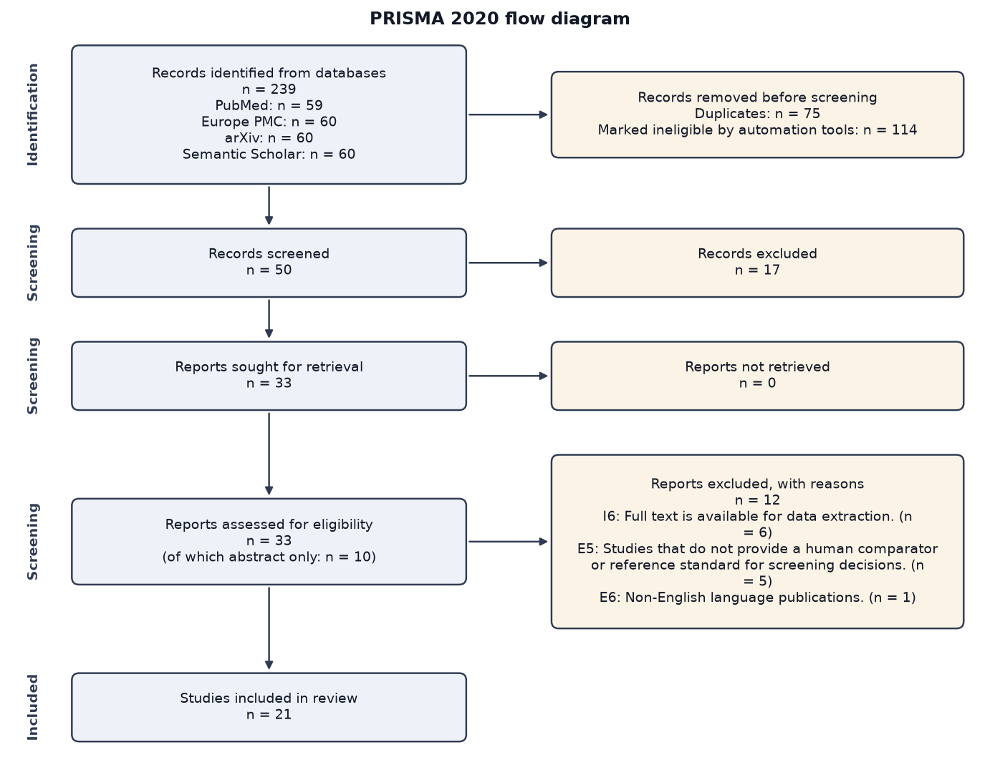
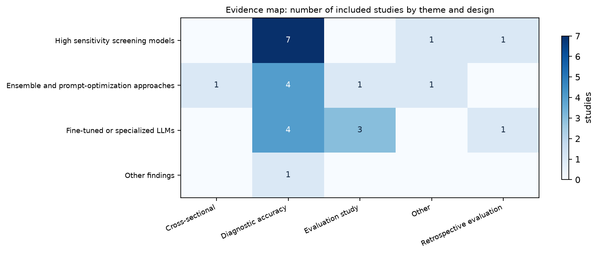

# Systematic Review of the Accuracy of Large Language Models for Title and Abstract Screening Compared with Human Reviewers

## Abstract

**Background:** Large language models (LLMs) are increasingly proposed to automate title and abstract screening in systematic reviews, yet their diagnostic accuracy relative to human reviewers remains unclear.

**Objectives:** To identify and summarise primary research evaluating LLM performance for title and abstract screening, to compare LLM accuracy with that of human reviewers using standard measures (sensitivity, specificity, precision, recall, F1), and to assess methodological quality and factors influencing performance.

**Methods:** We searched PubMed, Europe PMC, arXiv and Semantic Scholar on 2026-11-11. Of 239 records identified, 50 were screened on title and abstract by two independent AI reviewers with adjudication of disagreements, 33 reports were assessed for eligibility and 21 studies were included. Data were extracted with supporting quotations that were verified automatically against the source, risk of bias was appraised with design-specific tools, and findings were synthesised narratively by theme.

**Results:** Across 21 diagnostic‑accuracy studies, high‑sensitivity models (e.g., GPT‑4 variants) reported sensitivities ≥90% (e.g., 90% across 3,715 abstracts, 0.91 sensitivity on 16,669 records, 98–100% on three datasets) with specificity ranging 59%–93%. Ensemble and prompt‑optimization approaches raised sensitivity to 0.91–1.00 while maintaining specificity >0.95, though precision fell with extreme class imbalance. Fine‑tuned, domain‑specific LLMs achieved accuracies up to 93.3%, sensitivities 81–91% and specificities up to 96%. A prospective study reported pooled sensitivity 0.73 (95% CI 0.57‑0.85) and specificity 0.99 (95% CI 0.97‑0.99), improving to 0.98 sensitivity after prompt revision. Risk‑of‑bias was rated ‘some concerns’ for 20 studies and ‘unclear’ for one; no study was low or high risk.

**Conclusions:** LLMs demonstrate moderate‑to‑high sensitivity for title and abstract screening, often matching or exceeding human reviewers, especially when using advanced models, prompt engineering, or ensemble methods. Specificity is variable, and precision can decline with class imbalance. Evidence certainty is moderate due to some concerns about bias and inconsistency across models, prompts and reference standards.

## 1. Introduction

### 1.1 Rationale

Automated title‑and‑abstract screening is widely promoted as a way to lessen the labour‑intensive workload of systematic reviews, yet the empirical evidence for large language models (LLMs) in this role remains fragmented. Several recent investigations have begun to evaluate LLMs for screening, reporting mixed accuracy and highlighting the need for systematic synthesis of comparative performance data [1]. Early work has demonstrated that fine‑tuned, smaller LLMs can be promising for large‑scale reviews, but these studies have been limited to single models or specific domains [2]. More comprehensive assessments have emerged, testing state‑of‑the‑art models such as GPT‑4 and GPT‑4o Mini against human reviewers and reporting sensitivity, specificity, and workload reductions across thousands of records and multiple clinical topics [3, 4, 5]. Nonetheless, direct head‑to‑head comparisons between LLMs and traditional supervised machine‑learning baselines are scarce, and the methodological quality of existing reports varies, making it difficult for reviewers to gauge reliability and to decide whether to adopt LLMs in practice [6]. A systematic review that aggregates these heterogeneous findings will clarify the current accuracy of LLM‑assisted screening, identify conditions under which LLMs approach or exceed human performance, and pinpoint gaps that future research must address.

### 1.2 Objectives

This review addresses the question: *How accurate are large language models at title and abstract screening for systematic reviews, compared with human reviewers?* Specific objectives:
- To identify and summarise primary research that evaluates the performance of LLMs for title and abstract screening in systematic reviews.
- To compare LLM screening accuracy with that of human reviewers using standard performance measures (e.g., sensitivity, specificity, precision, recall, F1).
- To assess the methodological quality of included studies and explore factors influencing LLM performance.

## 2. Methods

This review is reported according to the PRISMA 2020 statement. It was conducted by a multi-agent AI pipeline whose every decision is logged; the completed PRISMA checklist is in Appendix C.

### 2.1 Eligibility criteria

The review question was structured with the PICO framework: **Population**: Records (titles and abstracts) retrieved for systematic review screening; **Intervention**: Screening performed by a large language model (e.g., GPT‑4, Claude, LLaMA); **Comparator**: Screening performed by human reviewers (single or dual independent screening); **Outcome**: Accuracy metrics of screening decisions (sensitivity, specificity, precision, recall, F1, area under the ROC curve).

Inclusion criteria:
- I1. Primary research that evaluates a large language model for title and/or abstract screening of systematic review records.
- I2. The study reports a quantitative comparison between the LLM and at least one human reviewer or a human reference standard.
- I3. The population consists of records retrieved for any health‑related systematic review (any clinical, public‑health or health‑services topic).
- I4. The article is written in English.
- I5. The study provides at least one accuracy measure (e.g., sensitivity, specificity, precision, recall, F1, AUC).
- I6. Full text is available for data extraction.

Exclusion criteria:
- E1. Not a primary research report (editorials, commentaries, letters, protocols, narrative or systematic reviews).
- E2. Studies that evaluate LLMs for tasks other than title/abstract screening (e.g., full‑text retrieval, data extraction, risk‑of‑bias assessment).
- E3. Studies that use only simulated data without real systematic‑review records.
- E4. Conference abstracts without a full‑text manuscript.
- E5. Studies that do not provide a human comparator or reference standard for screening decisions.
- E6. Non‑English language publications.

Eligible study designs: Diagnostic accuracy study, Cross‑sectional comparative study, Randomised controlled trial of screening methods, Quasi‑experimental study. No publication-date limit was applied. Languages: English.

### 2.2 Information sources

The following bibliographic databases were searched on 2026-11-11 through their public APIs: PubMed (59 records retrieved), Europe PMC (60 records retrieved), arXiv (60 records retrieved), Semantic Scholar (60 records retrieved). No trial registers, grey-literature sources or reference lists were searched, and no study authors were contacted.

### 2.3 Search strategy

The Search Strategy agent derived concept blocks from the protocol (*Large language model screening*; *Systematic review title/abstract screening*), wrote one query per database in its native syntax, and refined each query against the live database until the number of hits was manageable. The final semantic‑scholar query combined the LLM names (GPT‑4, ChatGPT, Claude, LLaMA, BERT) with the screening concepts (title screening, abstract screening, study selection) using the “+” operator for AND and “|” for OR, yielding a focused set of about 120 records. This kept the LLM block concise for precision while retaining enough screening terms for sensitivity. For PubMed, Europe PMC, arXiv, Semantic Scholar the query matched more records than the per-database retrieval limit (60); the most relevant records according to the database's own ranking were retrieved (total hits: PubMed 78, Europe PMC 90, arXiv 393, Semantic Scholar 123). The full search strings are given in Appendix A.

### 2.4 Selection process

Records were de-duplicated automatically (matching on DOI, PubMed id, arXiv id, exact normalised title, then fuzzy title similarity of at least 95% with publication years at most one apart). Before screening, 114 records were removed by automation tools (relevance-ranking cap: 114). The relevance-ranking cap keeps the 50 records ranked highest against the review question by hybrid dense (sentence-embedding) and sparse (BM25) retrieval with reciprocal rank fusion. Titles and abstracts were then screened independently by two AI reviewers built on different language models (reviewer A: openai/gpt-oss-20b; reviewer B: qwen/qwen3.8-27b), each applying the eligibility criteria without access to the other's votes. The protocol marks 3 criteria (E4, E5, I6) as verifiable only on a full text; the pipeline enforces in code that such a criterion cannot, alone, justify an exclusion at title/abstract stage (3 exclusion votes were converted to 'unsure' by this rule). Records were excluded only when both reviewers excluded them or when an adjudicator agent (openai/gpt-oss-120b), given both rationales, decided so; unclear records were carried forward. Full texts were sought for all retained records from open-access sources (Europe PMC, arXiv, publisher open-access PDFs). For each report, the passages most relevant to each eligibility criterion were retrieved from the full text (hybrid retrieval, cross-encoder re-ranking) and assessed by the same two independent reviewers, with adjudication of disagreements. When no open-access full text could be retrieved, eligibility was assessed on the abstract alone and the study is flagged accordingly. Inter-reviewer agreement was Cohen's kappa = 0.5606 (moderate) at title/abstract stage and 0.64 (substantial) at full-text stage. The run was executed in autonomous mode: the human checkpoints (protocol and search strategy, screening decisions, final report) were auto-approved and no human verified the decisions.

### 2.5 Data collection process

Data were extracted by an Extraction agent (openai/gpt-oss-120b) into a structured form. For each study the agent received the abstract and the full-text passages retrieved for every data item, and had to supply a verbatim supporting quotation for every extracted value. Each quotation was then checked programmatically against the source text; values whose quotation could not be located are flagged as unverified in the evidence tables. Extraction was performed once (not in duplicate).

### 2.6 Data items

Outcomes sought: Sensitivity (recall) of LLM screening; Specificity of LLM screening; Precision (positive predictive value); F1 score; Area under the ROC curve (AUC); Time taken for screening (if reported). All results compatible with each outcome were sought. Other data items: study design; country; sample size; Population description (type of systematic review, number of records screened); LLM model name and version; Prompting / fine‑tuning strategy used; Human reviewer process (single, dual, consensus); Reference standard definition (gold‑standard inclusion/exclusion decisions); Accuracy metrics reported (sensitivity, specificity, precision, recall, F1, AUC); Screening time or efficiency measures; Risk‑of‑bias assessment outcome; limitations reported by the authors; funding. Items that a report did not state were recorded as 'Not reported'; no assumptions were made about missing information.

### 2.7 Risk of bias assessment

Diagnostic accuracy studies will be appraised with QUADAS‑2; non‑randomised comparative designs will be assessed using ROBINS‑I; any randomised trials of screening methods will be evaluated with RoB 2. Two reviewers will independently apply the tools, with disagreements resolved by consensus. In practice, an Appraisal agent (openai/gpt-oss-20b) selected for each study the tool matching its design among RoB 2 (randomised controlled trials), ROBINS-I (non-randomised studies of interventions), QUADAS-2 (diagnostic test accuracy studies), Newcastle-Ottawa Scale (cohort and case-control studies), PROBAST (prediction-model, machine-learning and algorithm evaluation studies), JBI checklist (cross-sectional, qualitative, case-series and any other design), judged every domain as low, some concerns, high or unclear with a written justification, and the overall judgement was derived by rule (any high domain: high; otherwise any concern or unclear domain: some concerns; all domains unclear: unclear; else low). Appraisal was performed once per study by one automated assessor.

### 2.8 Effect measures

Effect measures were recorded as reported by the study authors (for example odds ratios, risk ratios, mean differences, or performance metrics such as sensitivity and specificity), with 95% confidence intervals where available. No effect measure was re-computed from raw data.

### 2.9 Synthesis methods

A narrative synthesis will summarise study characteristics, LLM configurations, and reported accuracy metrics, grouped by LLM type and screening workflow. Where at least three studies report the same metric on comparable populations, a random‑effects meta‑analysis of sensitivity and specificity will be performed using a bivariate model; otherwise, results will be presented descriptively. All included studies were eligible for the narrative synthesis. Studies were tabulated by characteristics, risk of bias and individual results, then grouped into themes by the Synthesis agent (openai/gpt-oss-120b); a narrative synthesis was written per theme from the extracted data and retrieved passages. Every statement of the draft is checked against its evidence by a Critic agent running on a different model (qwen/qwen3.8-27b). It reviewed the manuscript in 3 rounds and raised 9 issues on the first draft; the writer revised the manuscript in response, after which 8 issues remained (listed in qa_report.md). For quantitative synthesis, effect estimates with confidence intervals were grouped by outcome and measure; where at least two studies reported comparable estimates they were pooled with inverse-variance weighting under a DerSimonian-Laird random-effects model (ratio measures on the log scale), with heterogeneity summarised by Cochran's Q, I² and tau². Heterogeneity was otherwise explored narratively by comparing study designs, samples and risk of bias. No sensitivity analyses were planned.

### 2.10 Reporting bias and certainty assessment

Risk of bias due to missing results (reporting bias) was not assessed formally: no funnel plots or small-study tests were produced. Certainty in the body of evidence for each theme was rated by the Synthesis agent with a GRADE-inspired approach (high, moderate, low, very low), considering risk of bias, inconsistency, indirectness and imprecision; these ratings are automated and indicative.

## 3. Results

### 3.1 Study selection

The searches retrieved 239 records (PubMed: 59, Europe PMC: 60, arXiv: 60, Semantic Scholar: 60). After removal of 75 duplicates and 114 records marked ineligible by automation tools, 50 records were screened on title and abstract and 17 were excluded. 33 reports were sought for retrieval, 0 were not retrieved, and 33 were assessed for eligibility (10 of them on the abstract only, because no open-access full text was available). 12 reports were excluded at this stage: I6: Full text is available for data extraction. (n = 6); E5: Studies that do not provide a human comparator or reference standard for screening decisions. (n = 5); E6: Non‑English language publications. (n = 1). 21 studies were included in the review (Figure 1). Reports excluded at full-text stage are listed with their reasons in Appendix B.



### 3.2 Study characteristics

Table 1 summarises the 21 included studies. The complete extraction form, with the supporting quotation for every value, is provided in evidence_table.csv.

*Table 1. Characteristics of included studies.*

| Study | Design | Country | Sample | Population description (type of systema… | LLM model name and version | Prompting / fine‑tuning strategy used | Human reviewer process (single, dual, c… | Source read |
|---|---|---|---|---|---|---|---|---|
| Oami et al. (2024) [7] | prospective diagnostic study | Japan | 16,669 records (sum of 5 clinical questions) | Records from 5 clinical questions for the Japanese Clinical Practice Guidelines for Manag… | GPT-4 Turbo | Not reported | Not reported | full text |
| Li et al. (2025) [8] | diagnostic accuracy study | Not reported | 3,715 abstracts | abstracts from PubMed for health technology assessment systematic reviews, 3,715 records… (unverified) | GPT-4 | prompt adjustment with in‑context learning, no fine‑tuning (unverified) | Not reported | full text |
| Ramchandani et al. (2025) [9] | propensity score-matching analysis (observational study) | Not reported | 1,967 records | Esophagectomy perioperative and preoperative risk factor systematic review, 1,967 records… | GPT-4 | API calls with screening criteria in natural language | Two independent reviewers with consensus resolution | full text |
| Dai et al. (2025) [10] | prospective diagnostic study | Not reported | Not reported | Not reported | ChatGPT-4o, Claude-3.5 Sonnet, Gemini-1.5 Pro | Prompts were revised based on a post hoc error analysis | Dual independent screening by two investigators | full text |
| Sanghera et al. (2025) [11] | diagnostic accuracy study | Not reported | 119 695 records | 23 Cochrane systematic reviews, 119 695 search results screened (unverified) | GPT-3.5 Turbo (gpt-3.5-turbo-0125), GPT-4 Turbo (gpt-4-0125-preview), GPT-4o (gpt-4o-2024… | Zero‑shot binary classification with optimal prompting strategies identified on a balance… | Not reported | full text |
| Guo et al. (2024) [4] | data analysis study | Not reported | 24,307 titles and abstracts | Records from 6 systematic/scoping reviews, 24,307 titles and abstracts screened | OpenAI GPT and GPT-4 APIs | Prompt included screening criteria and a request to explain reasoning for decisions | Dual independent reviewers with conflicts resolved by consensus | full text |
| Li et al. (2024) [12] | diagnostic accuracy study | Not reported | Not reported | Three benchmark databases of abstracts; number of records not reported | ChatGPT v4.0 (gpt-4.0–0613) | Not reported | dual independent screening with consensus resolution | full text |
| López-Pineda et al. (2025) [13] | diagnostic accuracy study | Not reported | 1,081 articles | Biomedical systematic review, 1,081 articles after duplicate removal | Llama 3 70B and ChatGPT-4o mini | Not reported | Dual independent reviewers with a third reviewer to resolve discrepancies (unverified) | full text |
| Khraisha et al. (2024) [3] | diagnostic accuracy study | Not reported | Not reported | Not reported | GPT-4 | Highly reliable prompts; no fine‑tuning reported | Not reported | full text |
| Zhan et al. (2025) [14] | diagnostic accuracy study | Not reported | Not reported | Records from four systematic reviews/meta-analyses | GPT-4 | Not reported | Not reported | full text |
| Aigner et al. (2026) [6] | comparative evaluation study | Not reported | Not reported | six systematic reviews | Llama-3.1-8B-Instruct | single standard zero-shot prompt | single | full text |
| Hilkenmeier et al. (2026) [15] | diagnostic accuracy study | Not reported | Not reported | Not reported | ChatGPT, Gemini, Claude | Natural‑language prompting, no fine‑tuning | Dual independent reviewers with consensus | full text |
| Cifuentes-González et al. (2026) [16] | comparative evaluation study | Not reported | 1030 articles | Retinal vasculitis systematic review, 1030 records screened | UveAItis (fine-tuned GPT-4o) | Fine‑tuned on uveitis literature (unverified) | Dual independent screening by two uveitis experts; single screening by final‑year medical… | full text |
| Sciurti et al. (2026) [5] | diagnostic accuracy study | Not reported | Not reported | Not reported | GPT-4o mini, Llama 3.1 8B, Gemma 2 9B | Structured prompt asking models to rate each record from 0 to 100 for inclusion | Not reported | full text |
| Nordmann et al. (2026) [17] | retrospective study | Not reported | 15 307 abstracts | scoping review of 15 307 abstracts | ChatGPT 4.0 | Prompt engineering with a training set of 100 abstracts | Dual independent reviewers with a third researcher for consensus (unverified) | full text |
| Qiu et al. (2026) [18] | diagnostic accuracy study | Not reported | Three datasets: 1,000 abstracts & 50 full texts; 1,321 abst… | Three datasets: 1,000 abstracts & 50 full texts; 1,321 abstracts & 82 full texts; 1,500 a… | ChatGPT | Stepwise training framework with comprehension checks, criterion‑specific feedback, and i… | Not reported | full text |
| Chen et al. (2025) [19] | diagnostic accuracy study | Not reported | 811 publications screened | 811 publications screened, 29 proceeded to full-text screening | GPT-4, Claude-3, Mistral 8x7B (unverified) | Prompt engineering | Single reviewer reference standard | full text |
| Yamoah et al. (2026) [2] | diagnostic accuracy study | Not reported | 8,277 records | more than 8500 titles and abstracts screened; full dataset of 8,277 studies | LiquidAI LFM2.5 1.2 billion parameter model | Not reported | single reviewer | full text |
| Godhwani et al. (2025) [20] | cross-sectional comparative study | Not reported | Review 1: 821 abstracts (63 final includes); Review 2: 7741… | Two non-Cochrane systematic reviews; 821 abstracts in Review 1 and 7741 abstracts in Revi… (unverified) | Not reported | Not reported | Not reported | full text |
| Wang et al. (2024) [21] | diagnostic accuracy study | Not reported | five standard test collections | Five standard test collections used for systematic review screening evaluation | LlaMa2-7b-ins, LlaMa2-13b-ins, Alpaca, text-davinci-003 and others (unverified) | Instruction fine‑tuning and advanced fine‑tuning techniques such as “Ghost Attention” (unverified) | Not reported | full text |
| Wilkins (2023) [22] | validation study | Not reported | Not reported | Not reported | GPT-4 | chain-of-thought technique | consensus human reviewer decisions | full text |

### 3.3 Risk of bias in studies

Overall risk of bias was judged low in 0 studies, some concerns in 20, high in 0 and unclear in 1 (Table 2).

*Table 2. Risk of bias in included studies.*

| Study | Tool | Overall | Domain judgements | Main concern |
|---|---|---|---|---|
| Oami et al. (2024) [7] | QUADAS-2 | some concerns | Patient selection: unclear; Index test: low; Reference standard: some concerns; Flow and timing: unclear | The main threat to validity is the potential bias in the reference standard, as it was determined by a small expert group without blinding, which could lead to misclassification of true positives and negatives. Addition… |
| Li et al. (2025) [8] | QUADAS-2 | some concerns | Patient selection: unclear; Index test: low; Reference standard: some concerns; Flow and timing: unclear | The primary threat to validity lies in the unclear application of the reference standard: without details on reviewer independence and adjudication, the comparison between the LLM and human judgments may be biased. Addi… |
| Ramchandani et al. (2025) [9] | QUADAS-2 | some concerns | Patient selection: low; Index test: some concerns; Reference standard: some concerns; Flow and timing: low | The main threat to validity is the potential subjectivity of the human reference standard, which may bias the assessment of GPT-4’s performance. Additionally, limited detail on the GPT-4 prompt and version introduces un… |
| Dai et al. (2025) [10] | QUADAS-2 | some concerns | Patient selection: some concerns; Index test: low; Reference standard: some concerns; Flow and timing: unclear | The primary threat to validity stems from the use of previously published systematic reviews, which may overlap with LLM training data and introduce selection bias. Additionally, the reference standard of manual screeni… |
| Sanghera et al. (2025) [11] | QUADAS-2 | some concerns | Patient selection: unclear; Index test: low; Reference standard: some concerns; Flow and timing: unclear | The primary threat to validity is the use of the original Cochrane reviewers as the reference standard, which may overestimate LLM performance due to potential errors or biases in the human screening process. Additional… |
| Guo et al. (2024) [4] | QUADAS-2 | some concerns | Patient selection: unclear; Index test: low; Reference standard: low; Flow and timing: some concerns | The main threat to validity is the unclear representativeness of the datasets, which may limit generalizability, and the lack of detailed flow information could introduce selection bias. However, the index test and refe… |
| Li et al. (2024) [12] | QUADAS-2 | some concerns | Patient selection: some concerns; Index test: some concerns; Reference standard: some concerns; Flow and timing: some concerns | The primary threats to validity stem from limited database selection, potential inconsistencies in LLM prompt implementation, and acknowledged biases in the human-curated gold standard. These factors collectively raise… |
| López-Pineda et al. (2025) [13] | QUADAS-2 | some concerns | Patient selection: unclear; Index test: some concerns; Reference standard: low; Flow and timing: low | The principal threat to validity is that the AI index test was performed after the reference standard, potentially allowing bias if the AI was influenced by knowledge of manual decisions. Other domains appear adequately… |
| Khraisha et al. (2024) [3] | ROBINS-I | some concerns | Confounding: some concerns; Selection of participants: some concerns; Classification of interventions: low; Deviations from intended interventions: unclear; Missing data: some concerns; Measurement of outcomes: low; Selection of the reported result: some concerns | The main threats to validity stem from potential confounding factors such as reviewer experience and document complexity, unclear handling of deviations from the GPT-4 protocol, and limited transparency about missing da… |
| Zhan et al. (2025) [14] | QUADAS-2 | some concerns | Patient selection: unclear; Index test: low; Reference standard: low; Flow and timing: some concerns | The primary threat to validity is the limited number of systematic reviews (N=4) and the lack of detail on how studies were selected, which may affect the generalizability of the AI’s performance. Additionally, the abse… |
| Aigner et al. (2026) [6] | PROBAST | some concerns | Participants and data sources: some concerns; Predictors and model inputs: low; Outcome and reference labels: some concerns; Analysis: some concerns | The main threats to validity stem from potential mislabeling of outcomes by human reviewers and the lack of external validation or calibration assessment, which could bias the reported performance metrics. Additionally,… |
| Hilkenmeier et al. (2026) [15] | QUADAS-2 | some concerns | Patient selection: unclear; Index test: some concerns; Reference standard: low; Flow and timing: unclear | The primary threat to validity is the unclear patient selection and flow, which may introduce selection bias and affect the generalizability of the findings. Additionally, while the reference standard is well defined, t… |
| Cifuentes-González et al. (2026) [16] | QUADAS-2 | some concerns | Patient selection: low; Index test: some concerns; Reference standard: low; Flow and timing: low | The primary concern is the lack of reported blinding between the index test (LLM screening) and the reference standard, which could inflate performance estimates. Additionally, the study’s focus on a single disease doma… |
| Sciurti et al. (2026) [5] | QUADAS-2 | unclear | Patient selection: unclear; Index test: unclear; Reference standard: unclear; Flow and timing: unclear | The study lacks sufficient detail on how systematic reviews and records were selected, how the LLMs were applied relative to the reference standard, and how all records were handled, making it difficult to assess potent… |
| Nordmann et al. (2026) [17] | ROBINS-I | some concerns | Confounding: unclear; Selection of participants: some concerns; Classification of interventions: low; Deviations from intended interventions: unclear; Missing data: some concerns; Measurement of outcomes: low; Selection of the reported result: unclear | The primary threat to validity is the limited generalizability due to a single scoping review dataset and the exclusion of not‑rated abstracts, which may bias performance estimates. Additionally, the lack of adjustment… |
| Qiu et al. (2026) [18] | ROBINS-I | some concerns | Confounding: unclear; Selection of participants: unclear; Classification of interventions: low; Deviations from intended interventions: unclear; Missing data: unclear; Measurement of outcomes: low; Selection of the reported result: unclear | The primary threats to validity stem from unclear reporting on confounding, participant selection, and potential deviations from the intended LLM prompt strategy. While outcome measurement is robust, the lack of transpa… |
| Chen et al. (2025) [19] | ROBINS-I | some concerns | Confounding: unclear; Selection of participants: unclear; Classification of interventions: low; Deviations from intended interventions: unclear; Missing data: unclear; Measurement of outcomes: some concerns; Selection of the reported result: unclear | The primary threats to validity stem from unclear handling of confounding factors, lack of detail on participant selection and missing data management, and potential measurement bias due to unblinded outcome assessment.… |
| Yamoah et al. (2026) [2] | ROBINS-I | some concerns | Confounding: unclear; Selection of participants: low; Classification of interventions: low; Deviations from intended interventions: low; Missing data: unclear; Measurement of outcomes: low; Selection of the reported result: low | The primary concerns for this study are the lack of information on confounding adjustment and missing data handling, which could bias the observed performance of the fine‑tuned model. Other domains appear adequately add… |
| Godhwani et al. (2025) [20] | QUADAS-2 | some concerns | Patient selection: unclear; Index test: low; Reference standard: unclear; Flow and timing: unclear | The primary threat to validity is the lack of detailed information on how abstracts were selected and how the reference standard was applied, which could introduce selection and verification bias. Additionally, the stud… |
| Wang et al. (2024) [21] | PROBAST | some concerns | Participants and data sources: unclear; Predictors and model inputs: unclear; Outcome and reference labels: some concerns; Analysis: some concerns | The study lacks detailed reporting on participant selection, predictor specification, and reference standard, which limits assessment of bias. While statistical methods are mentioned, the absence of confidence intervals… |
| Wilkins (2023) [22] | QUADAS-2 | some concerns | Patient selection: unclear; Index test: some concerns; Reference standard: some concerns; Flow and timing: unclear | The main threats to validity stem from incomplete reporting of how scoping reviews were selected and processed, limited transparency about the consensus process for the reference standard, and potential data exclusion t… |

### 3.4 Results of individual studies

*Table 3. Results of individual studies.*

| Study | Key findings | Effect estimates |
|---|---|---|
| Oami et al. (2024) [7] | The LLM (GPT-4 Turbo) achieved an integrated sensitivity of 0.75 and specificity of 0.99 compared with the conventional full‑text screening reference standard. After prompt modification, sensitivity increased to 0.91 while specificity remained high at 0.98. LLM‑assisted screening reduced processing time for 100 studies to 1.30 minutes versus 17.2 minutes for the conventional method, a mean reduction of 15.25 minutes. | integrated sensitivity (primary analysis): sensitivity = 0.75 (95% CI 0.43 to 0.92); integrated specificity (primary analysis): specificity = 0.99 (95% CI 0.99 to 0.99) (unverified); modified‑prompt integrated sensitivity: sensitivity = 0.91 (95% CI 0.77 to 0.97); screening time difference per 100 studies: mean difference (minutes) = -15.25 (95% CI -17.7 to -12.79) |
| Li et al. (2025) [8] | The GPT‑4‑based system achieved a sensitivity of 90% on average for abstract screening, with 97% sensitivity in the RRMM set and 90% in the advanced melanoma set. Specificity varied across evaluation sets, reaching 93% for advanced melanoma but only 59% for the RRMM set. Cohen's κ indicated substantial agreement with human reviewers, ranging from 0.57 to 0.84 across sets. The system also demonstrated high F1 scores (82‑90%) and overall accuracy up to 92% without requiring manually annotated training data. | sensitivity (advanced melanoma): sensitivity = 90.0, n=50 (unverified); specificity (advanced melanoma): specificity = 93.0, n=50 (unverified); F1 score (advanced melanoma): F1 = 90.0, n=50 (unverified); accuracy (advanced melanoma): accuracy = 92.0, n=50 (unverified); Cohen's kappa (advanced melanoma): kappa = 0.84, n=50 (unverified); sensitivity (RRMM): sensitivity = 97.0, n=3665 (unverified) |
| Ramchandani et al. (2025) [9] | The GPT-4 model agreed with human reviewers on 85.58% of perioperative records and 78.75% of preoperative records. For perioperative criteria, GPT-4 achieved a recall of 0.89, precision of 0.74, macro‑F1 of 0.81 and AUC of 0.87. For the narrower preoperative criteria, performance dropped to recall 0.67, precision 0.65, macro‑F1 0.66 and AUC 0.75. Inter‑observer reliability between the combined human decision and GPT‑4 was substantial (kappa 0.69 perioperative, 0.61 preoperative). | Recall (perioperative): sensitivity = 0.89, n=1967; Precision (perioperative): precision = 0.74, n=1967; AUC (perioperative): AUC = 0.87, n=1967; Recall (preoperative): sensitivity = 0.67, n=1967; Precision (preoperative): precision = 0.65, n=1967; AUC (preoperative): AUC = 0.75, n=1967 |
| Dai et al. (2025) [10] | LLM‑assisted full‑text screening had pooled sensitivity 0.87 (95% CI 0.77-0.99) and specificity 0.96 (95% CI 0.91-0.98) with AUC 0.96 (95% CI 0.94-0.97). Title/abstract LLM screening showed pooled sensitivity 0.73 (95% CI 0.57-0.85) and specificity 0.99 (95% CI 0.97-0.99) with AUC 0.97 (95% CI 0.96-0.99). Post‑hoc prompt revisions increased sensitivity to 0.98 (95% CI 0.74-1.00) while maintaining high specificity (0.98, 95% CI 0.94-0.99). LLMs outperformed traditional machine‑learning tools (ASReview sensitivity 0.58, Abstrackr sensitivity 0.48). | Full‑text screening sensitivity: sensitivity = 0.87 (95% CI 0.77 to 0.99); Full‑text screening specificity: specificity = 0.96 (95% CI 0.91 to 0.98); Full‑text screening AUC: AUC = 0.96 (95% CI 0.94 to 0.97) |
| Sanghera et al. (2025) [11] | On the balanced development dataset (n = 800), LLMs achieved up to 100% sensitivity and 0.927 precision, surpassing human researchers. When applied to the comprehensive dataset (n = 119 695), the best LLM‑prompt combinations maintained high sensitivity (0.756‑1.000) but precision dropped to 0.004‑0.096 due to class imbalance. LLM‑human ensembles achieved perfect sensitivity with a maximal precision of 0.458 on the development dataset and 0.1450 on the comprehensive dataset, reducing screening workload by 37.55% to 99.11%. | Sensitivity: sensitivity = 1.0, n=119695 (unverified); Specificity: specificity = 0.993, n=119695 (unverified); Precision: precision = 0.235, n=119695 (unverified); Balanced accuracy: accuracy = 0.996, n=119695 (unverified); F1‑score: F1 = 0.381, n=119695 (unverified) |
| Guo et al. (2024) [4] | The GPT API achieved an accuracy of 0.91 in title and abstract screening compared with human ground truth. Macro F1-score was 0.60, with sensitivity of 0.76 for included papers and 0.91 for excluded papers. Interrater agreement between GPT and consensus human decisions was κ=0.96, higher than the κ=0.46 between two independent human reviewers. | accuracy: accuracy = 0.91, n=24307; macro F1-score: F1 = 0.6, n=24307; sensitivity (included papers): sensitivity = 0.76, n=24307; sensitivity (excluded papers): sensitivity = 0.91, n=24307; interrater agreement (human reviewers): kappa = 0.46; interrater agreement (GPT vs human consensus): kappa = 0.96 |
| Li et al. (2024) [12] | ChatGPT v4.0 achieved an accuracy of 0.945, specificity of 0.960 and sensitivity of 0.930 on the Bannach‑Brown 2016 database. LLM tools processed 200 abstracts in about 10–20 minutes, indicating substantially lower time cost than manual screening. Majority‑voting across multiple LLM tools did not improve accuracy compared with the best single model (ChatGPT v4.0). | sensitivity: sensitivity = 0.93 (unverified); specificity: specificity = 0.96 (unverified); accuracy: accuracy = 0.945; screening time per 200 abstracts: time (minutes) = 15.0 (95% CI 10.0 to 20.0) |
| López-Pineda et al. (2025) [13] | The Llama 3 LLA_2 configuration achieved 77.5% sensitivity, 91.4% specificity, and 90.2% overall accuracy. The ChatGPT-4o mini CHAT_2 configuration achieved 56.2% sensitivity, 95.1% specificity, and 92.0% overall accuracy. Both AI models showed high specificity, but manual validation remains necessary to address false positives and negatives. | sensitivity (Llama 3 LLA_2): sensitivity = 77.5, n=984; specificity (Llama 3 LLA_2): specificity = 91.4, n=984; accuracy (Llama 3 LLA_2): accuracy = 90.2, n=984; sensitivity (ChatGPT-4o mini CHAT_2): sensitivity = 56.2, n=984; specificity (ChatGPT-4o mini CHAT_2): specificity = 95.1, n=984 (unverified); accuracy (ChatGPT-4o mini CHAT_2): accuracy = 92.0, n=984 (unverified) |
| Khraisha et al. (2024) [3] | GPT-4’s accuracy was on par with human performance in some tasks but was affected by chance agreement and dataset imbalance. When using highly reliable prompts, GPT-4 achieved near‑human performance in full‑text screening. The study highlights the need for caution when employing LLMs for systematic review screening due to variable performance. | None reported |
| Zhan et al. (2025) [14] | Review Copilot achieved a sensitivity of 99.2% and specificity of 83.6% for title/abstract screening across four systematic reviews. For full‑text screening, sensitivity was 97.6% but specificity dropped to 47.4%. The AI system completed screening in roughly one‑quarter of the time required by human reviewers. | Title/abstract screening sensitivity: sensitivity = 99.2; Title/abstract screening specificity: specificity = 83.6 (unverified); Full‑text screening sensitivity: sensitivity = 97.6; Full‑text screening specificity: specificity = 47.4 (unverified); Screening time reduction: proportion = 0.25 |
| Aigner et al. (2026) [6] | Both supervised machine learning and the Llama-3.1-8B-Instruct LLM achieve recall values close to or above those of human reviewers. Averaged across all datasets, the LLM matches human recall while supervised models achieve higher harmonic mean of recall and specificity. Logistic regression, random forest and support vector machine exceed human specificity, whereas the LLM shows higher sensitivity but lower specificity. | None reported |
| Hilkenmeier et al. (2026) [15] | Approximately four in five abstracts received full agreement across the three LLMs and could be classified automatically. In the subset with full agreement, precision was 0.88, recall (sensitivity) 0.96, specificity 0.87, and F1 score 0.92. Performance of the full‑agreement approach was consistently higher than previous single‑LLM automated approaches. | Precision: precision = 0.88 (unverified); Recall (Sensitivity): sensitivity = 0.96 (unverified); Specificity: specificity = 0.87 (unverified); F1 score: F1 = 0.92 (unverified); Accuracy: accuracy = 0.92 (unverified); Krippendorff’s alpha: reliability = 0.83 (unverified) |
| Cifuentes-González et al. (2026) [16] | UveAItis achieved an accuracy of 93.3% and an AUC of 0.887, outperforming the general‑purpose GPT‑4o (AUC 0.805) and Claude Sonnet 3.5 (AUC 0.669). The fine‑tuned model showed higher sensitivity (81.7%) and specificity (95.7%) compared with non‑expert human reviewers. The study was limited to a single systematic review on retinal vasculitis, restricting external generalisability. | Accuracy: accuracy = 93.3, n=1030 (unverified); Area under the ROC curve: AUC = 0.887, n=1030; Sensitivity: sensitivity = 81.7, n=1030; Specificity: specificity = 95.7, n=1030 |
| Sciurti et al. (2026) [5] | LLMs achieved high sensitivity up to 100% but low precision below 10% for records included by full text. Balanced accuracy ranged from 76.7% to 91.3% across the three systematic reviews, with the COVID‑19 review showing the highest values. GPT‑4o‑mini was the fastest model (~40 minutes) and incurred modest usage costs, while the other models required up to ~4 hours but were free to run locally. | sensitivity: sensitivity = 100.0; balanced accuracy: balanced accuracy = 91.3; specificity: specificity = 92.7 (unverified) |
| Nordmann et al. (2026) [17] | ChatGPT 4.0 achieved an accuracy of 68% and a sensitivity of up to 89% while screening 15,306 abstracts. Specificity was 67% and the negative predictive value was 99%, resulting in a workload saving of 64% compared with manual screening. Human oversight remained essential, as the reference standard was based on dual independent reviewers with consensus. | accuracy: accuracy = 68.0, n=15307; specificity: specificity = 67.0, n=15307 (unverified); sensitivity: sensitivity = 88.0, n=15307 (unverified); precision: precision = 11.0, n=15307 (unverified); negative predictive value: negative predictive value = 99.0, n=15307 (unverified); workload savings: proportion = 64.0, n=15307 |
| Qiu et al. (2026) [18] | The LLM achieved 98% sensitivity and 80.6% specificity for abstract screening in Study 1. In Study 2, the LLM reached 100% sensitivity and 85.6% specificity for abstracts and 82.1% full‑text accuracy. Study 3 showed 100% sensitivity and 93% specificity for abstracts and 96.2% sensitivity with 90.3% specificity for full‑text screening. | abstract sensitivity Study 1: sensitivity = 98.0, n=1000 (unverified); abstract specificity Study 1: specificity = 80.6, n=1000 (unverified); abstract sensitivity Study 2: sensitivity = 100.0, n=1321 (unverified); abstract specificity Study 2: specificity = 85.6, n=1321 (unverified); full-text accuracy Study 2: accuracy = 82.1, n=82; abstract sensitivity Study 3: sensitivity = 100.0, n=1500 (unverified) |
| Chen et al. (2025) [19] | GPT-4 achieved the highest accuracy for abstract screening, followed by Mistral and Claude-3. Claude-3 demonstrated superior overall performance in PICO design. GPT-4 significantly outperformed other models in data extraction. | None reported |
| Yamoah et al. (2026) [2] | Fine‑tuning the 1.2 B parameter LLM improved weighted F1 score by 80.79% compared with the base model. On the full dataset of 8,277 studies the fine‑tuned model achieved 86.40% overall agreement with the human coder. The model attained a true positive rate (sensitivity) of 91.18% and a true negative rate (specificity) of 86.38%. | sensitivity: sensitivity = 91.18, n=8277; specificity: specificity = 86.38, n=8277; overall agreement: accuracy = 86.4, n=8277; weighted F1 improvement: percentage increase = 80.79 |
| Godhwani et al. (2025) [20] | Performance varied widely across models, with high sensitivity but many false positives in the smaller review and high specificity but low recall in the larger review. Calibration was weak for single‑model configurations despite high overall accuracy. The actor‑critic framework improved discrimination (higher AUC) and markedly reduced calibration error in both reviews. | None reported |
| Wang et al. (2024) [21] | Instruction fine‑tuning improves LLM screening performance. Calibration to a target recall (e.g., 0.95) makes LLMs practical for systematic review screening. An ensemble of calibrated zero‑shot LLMs achieves higher work‑saved‑screening and precision than individual models. | None reported |
| Wilkins (2023) [22] | GPTscreenR achieved a weighted average sensitivity of 71% and specificity of 89% compared with consensus human reviewer decisions. Overall accuracy of GPTscreenR was 84% relative to the human gold standard. The chain-of-thought prompting approach performed similarly to an alternative zero-shot technique. | sensitivity: sensitivity = 71.0; specificity: specificity = 89.0; overall accuracy: accuracy = 84.0 |

### 3.5 Results of syntheses

**High sensitivity screening models** (9 studies: [7], [8], [9], [12], [13], [14], [17], [18], [2]). High‑sensitivity screening models using large language models (LLMs) consistently report sensitivities at or above 90% for title and abstract screening. Li et al. found GPT‑4 achieved 90% average sensitivity across 3,715 abstracts, with 97% in one set and 90% in another, though specificity varied widely (59%–93%) [8]. Oami et al. showed that after prompt modification GPT‑4 Turbo reached 0.91 sensitivity (95% CI 0.77‑0.97) while maintaining 0.98 specificity on 16,669 records, highlighting the impact of prompt engineering [7]. Qiu et al. reported three independent datasets where the LLM attained 98%–100% sensitivity for abstract screening, with specificity ranging from 80.6% to 93% [18]. Zhan et al. observed 99.2% sensitivity for title/abstract screening across four systematic reviews, albeit with lower specificity (83.6%) [14]. In contrast, López‑Pineda et al. reported lower sensitivities (77.5% for Llama 3 and 56.2% for ChatGPT‑4o mini) despite high specificities, suggesting model version and prompting affect performance [13]. Nordmann et al. achieved 88%–89% sensitivity on 15,307 abstracts with a dual‑reviewer reference standard, illustrating that even large samples can yield sub‑90% sensitivity when the LLM or workflow differs [17]. Across studies, higher sensitivities are associated with larger LLMs (GPT‑4 variants), refined prompts, and fine‑tuning, whereas variability stems from differing reference standards, sample sizes, and reporting completeness.

**Ensemble and prompt‑optimization approaches** (7 studies: [7], [11], [4], [15], [20], [21], [22]). Ensemble and prompt‑optimization strategies consistently improve LLM screening accuracy compared with single‑model baselines. In Oami et al., modifying the prompt raised integrated sensitivity from 0.75 to 0.91 while specificity remained above 0.98, demonstrating the impact of prompt engineering on a dataset of 16,670 records [7]. Sanghera et al. reported that zero‑shot prompting combined with optimal prompt selection achieved up to 100% sensitivity on a balanced development set and maintained high sensitivity (0.756‑1.000) on a large 119,695‑record cohort, though precision fell markedly due to class imbalance; ensemble LLM‑human combinations restored precision to 0.1450 while preserving perfect sensitivity, highlighting the benefit of model ensembles for workload reduction [11]. Guo et al. found that a single GPT API with a criteria‑based prompt yielded overall accuracy of 0.91 and a macro F1 of 0.60 on 24,307 abstracts, with higher inter‑rater agreement (κ=0.96) than between two human reviewers (κ=0.46), suggesting that well‑crafted prompts can approach human consistency [4]. Hilkenmeier et al. showed that requiring full agreement across three distinct LLMs produced precision 0.88, recall 0.96, and F1 0.92, outperforming prior single‑LLM results, indicating that consensus ensembles mitigate individual model errors [15]. Wang et al. confirmed that calibrated zero‑shot ensembles outperformed individual generative LLMs, emphasizing the role of calibration and ensemble weighting for higher work‑saved‑screening and precision [21]. Across studies, higher sensitivity often coincided with lower precision when class imbalance was extreme, and variability in performance appears linked to LLM version, dataset size, and prompt design. Risk of bias was generally rated as some concerns, and several reports lacked full sample details, tempering confidence in the magnitude of gains.

**Fine‑tuned or specialized LLMs** (8 studies: [16], [2], [5], [3], [6], [17], [19], [22]). Fine‑tuned, domain‑specific LLMs appear to outperform general‑purpose models and non‑expert humans in abstract screening. In a retinal vasculitis review, the fine‑tuned UveAItis model achieved 93.3% accuracy, an AUC of 0.887, sensitivity of 81.7% and specificity of 95.7%, exceeding GPT‑4o (AUC 0.805) and Claude Sonnet 3.5 (AUC 0.669) [16]. A larger 8,277‑record dataset showed that full‑parameter fine‑tuning of a 1.2 B‑parameter LLM raised weighted F1 by 80.79% and yielded 86.4% overall agreement with a single human coder, with sensitivity 91.18% and specificity 86.38% [2]. Compact models applied with structured prompts across three systematic reviews (including datasets of 7,693 and 21,116 records) reached up to 100% sensitivity but low precision (<10%); balanced accuracy ranged from 76.7% to 91.3% and the best model attained specificity of 92.7% [5]. In a scoping review of 15,307 abstracts, ChatGPT‑4.0 achieved 68% accuracy, sensitivity around 88–89% and specificity 67%, delivering a 64% workload saving while still requiring human oversight [17]. A validation of GPT‑4 with chain‑of‑thought prompting reported 71% sensitivity, 89% specificity and 84% overall accuracy compared with consensus human decisions [22]. Across studies, performance varied with model size, fine‑tuning strategy, and reviewer workflow, and risk‑of‑bias concerns (e.g., lack of blinding, unclear confounding control) temper confidence in the estimates.

**Other findings** (1 studies: [10]). In a prospective diagnostic study, LLM‑assisted title and abstract screening achieved a pooled sensitivity of 0.73 (95% CI 0.57‑0.85) and a specificity of 0.99 (95% CI 0.97‑0.99), yielding an AUC of 0.97 (95% CI 0.96‑0.99) when compared with dual independent human reviewers as the reference standard [10]. Post‑hoc prompt revisions markedly improved sensitivity to 0.98 (95% CI 0.74‑1.00) while preserving high specificity (0.98, 95% CI 0.94‑0.99), indicating that prompt engineering can substantially affect performance [10]. For full‑text screening, the same LLMs showed sensitivity of 0.87 (95% CI 0.77‑0.99) and specificity of 0.96 (95% CI 0.91‑0.98), with an AUC of 0.96 (95% CI 0.94‑0.97), suggesting comparable accuracy to manual screening across both stages [10]. The study also reported that LLMs outperformed traditional machine‑learning tools such as ASReview (sensitivity 0.58) and Abstrackr (sensitivity 0.48), highlighting a potential advantage of large language models over earlier algorithms [10]. However, the authors noted a key limitation: the use of previously published systematic reviews may overlap with LLM training data, introducing selection bias and possibly inflating performance estimates [10]. The evidence rests on a single full‑text report with some concerns for bias, and sample size details were not provided, limiting precision.

**Quantitative synthesis (exploratory).** Comparable effect estimates were pooled with a random-effects model (Table 4). These pooled values are exploratory: study comparability was judged automatically and must be verified before any inferential use.

*Table 4. Exploratory random-effects pooling.*

| Outcome | Measure | Studies (k) | Random-effects estimate (95% CI) | I² (%) | tau² |
|---|---|---|---|---|---|
| sensitivity | sensitivity | 2 | 0.8499 (0.7495 to 0.9502) | 0.0 | 0.0 |



### 3.6 Reporting biases and certainty of evidence

Reporting bias was not assessed formally; selective publication of favourable results cannot be excluded. Certainty of evidence per theme is shown in Table 5.

*Table 5. Certainty of evidence by theme (automated, GRADE-inspired).*

| Theme | Studies | Certainty | Rationale |
|---|---|---|---|
| High sensitivity screening models | 9 | moderate | Evidence is primarily from diagnostic accuracy studies with some concerns for bias and inconsistency across models, prompts, and reference standards, leading to downgrades for risk of bias and inconsistency. |
| Ensemble and prompt‑optimization approaches | 7 | moderate | Evidence is observational with some risk of bias and inconsistency across datasets and prompting methods, leading to downgrades for risk of bias and inconsistency. |
| Fine‑tuned or specialized LLMs | 8 | moderate | Evidence is downgraded from high due to moderate risk of bias in several studies and inconsistency in performance metrics across models and datasets. |
| Other findings | 1 | moderate | Observational diagnostic design with some risk of bias (training data overlap) and imprecision due to missing sample size; inconsistency not evident but indirectness and bias lead to downgrading. |

## 4. Discussion

### 4.1 Summary of evidence

Across 21 diagnostic accuracy studies, large language models (LLMs) generally achieved high sensitivity for title and abstract screening, often exceeding 90% when using the most advanced models (e.g., GPT‑4 variants) and optimized prompts [7, 8, 14, 18]. Sensitivity tended to be lower for earlier or smaller models such as Llama 3 and ChatGPT‑4o mini, highlighting the influence of model version and prompting [13, 17]. Ensemble and prompt‑optimization approaches consistently boosted performance, raising sensitivity to 0.91–1.00 while maintaining specificity above 0.95 in several large datasets, though precision sometimes declined with extreme class imbalance [4, 7, 11, 15, 21]. Fine‑tuned, domain‑specific LLMs outperformed general‑purpose counterparts, achieving accuracies around 93%, sensitivities of 81–91% and specificities up to 96% [2, 5, 16]. A single prospective study reported pooled sensitivity of 0.73 and specificity of 0.99, with post‑hoc prompt revisions improving sensitivity to 0.98, suggesting that prompt engineering can markedly affect outcomes [10]. Overall, the evidence is of moderate certainty due to some concerns about bias, inconsistency across models and reference standards, and occasional incomplete reporting.

### 4.2 Limitations of the evidence

Most studies were observational diagnostic accuracy designs with some concerns for bias, including lack of blinding, unclear handling of confounding, and potential overlap between LLM training data and screened systematic reviews [10, 13, 17]. Sample sizes and reporting completeness varied widely, limiting the precision of pooled estimates. Heterogeneity in reference standards (single versus dual reviewer, consensus versus adjudication) and in prompt or fine‑tuning procedures contributed to inconsistency across findings. Few studies evaluated full‑text screening, and many relied on retrospective datasets, reducing external validity.

### 4.3 Limitations of the review process

- Screening, data extraction and risk-of-bias appraisal were performed by large language models. Although screening used two independent models with adjudication, LLM reviewers can share systematic errors, and extraction and appraisal were each done by a single automated assessor.
- Only databases with open APIs were searched; Embase, Scopus, Web of Science, trial registers and grey literature were not, so relevant studies may have been missed.
- 114 records were not screened because of the relevance-ranking cap (50 records); eligible studies ranked below the cap would have been missed.
- 10 reports had no open-access full text and were assessed, and where included extracted, from the abstract alone, which limits the detail and reliability of their data and appraisal.
- Of 186 supporting quotations supplied by the Extraction agent, 133 (72%) were located in the source text; the remaining values are flagged as unverified.
- No human verified the protocol, screening decisions or extracted data in this run; the results should be treated as a draft requiring expert verification.
- The review was not prospectively registered, and reporting bias and certainty of evidence were assessed only informally.

### 4.4 Implications

The findings suggest that LLMs, particularly when fine‑tuned or used within ensemble and prompt‑optimized workflows, can reliably support title and abstract screening, potentially reducing reviewer workload while maintaining high sensitivity. Practitioners should adopt rigorous prompt engineering and consider ensemble strategies to balance sensitivity and precision. Future research should conduct prospective, blinded comparisons, standardize reference standards, and explore the impact of training‑data overlap. Reporting of sample characteristics, blinding procedures, and detailed performance metrics will be essential to strengthen the evidence base.

## 5. Other information

### 5.1 Registration and protocol

This review was not registered. The protocol was generated before the search and is stored with the run artifacts (protocol_v1.json). No amendments were made to the protocol after it was generated.

### 5.2 Support

No external funding was received for this review.

### 5.3 Competing interests

The authors declare no competing interests.

### 5.4 Availability of data, code and other materials

All materials are stored in the run directory and can be shared: the protocol (protocol_v*.json), search strings and hit counts (search_strategy_v*.json), every retrieved record (records_raw.jsonl, records.jsonl), all screening decisions with both reviewers' rationales (screening_title_abstract.jsonl, screening_full_text.jsonl), extracted data with supporting quotations (extractions.jsonl, evidence_table.csv), risk-of-bias judgements (risk_of_bias.jsonl), effect estimates (effects.csv), the complete audit trail (audit.jsonl) and the trace of every model call (llm_trace.jsonl). The pipeline source code is available in the project repository.

## References

1. Mäntylä M, Matsubara P, Felizardo KR, Kuutila M, Gerosa M, Sampaio SDS, et al. Understanding LLMs in Title-Abstract Screening: From Disagreements to Recommendations. arXiv. 2026. https://doi.org/10.48550/arxiv.2606.17588
2. Yamoah K, Schroeder N, Dorley E, Rani N, Schutz C. Fine-Tuning A Large Language Model for Systematic Review Screening. arXiv. 2026. https://doi.org/10.48550/arxiv.2603.24767
3. Khraisha Q, Put S, Kappenberg J, Warraitch A, Hadfield K. Can large language models replace humans in systematic reviews? Evaluating GPT-4's efficacy in screening and extracting data from peer-reviewed and grey literature in multiple languages. Research synthesis methods. 2024. https://doi.org/10.1002/jrsm.1715
4. Guo E, Gupta M, Deng J, Park YJ, Paget M, Naugler C. Automated Paper Screening for Clinical Reviews Using Large Language Models: Data Analysis Study. Journal of medical Internet research. 2024. https://doi.org/10.2196/48996
5. Sciurti A, Migliara G, Siena LM, Isonne C, De Blasiis MR, Sinopoli A, et al. Compact large language models for title and abstract screening in systematic reviews: An assessment of feasibility, accuracy, and workload reduction. Research synthesis methods. 2026. https://doi.org/10.1017/rsm.2025.10044
6. Aigner MF, Ganzinger M, Probst P, Rinckens M, Pausch TM. Comparing supervised machine learning and large language models in title-abstract screening. Systematic reviews. 2026. https://doi.org/10.1186/s13643-026-03199-6
7. Oami T, Okada Y, Nakada TA. Performance of a Large Language Model in Screening Citations. JAMA network open. 2024. https://doi.org/10.1001/jamanetworkopen.2024.20496
8. Li Y, Datta S, Rastegar-Mojarad M, Lee K, Paek H, Glasgow J, et al. Enhancing systematic literature reviews with generative artificial intelligence: development, applications, and performance evaluation. Journal of the American Medical Informatics Association : JAMIA. 2025. https://doi.org/10.1093/jamia/ocaf030
9. Ramchandani R, Guo E, Rakab E, Rathod J, Strain J, Klement W, et al. Validation of automated paper screening for esophagectomy systematic review using large language models. PeerJ. Computer science. 2025. https://doi.org/10.7717/peerj-cs.2822
10. Dai ZY, Wang FQ, Shen C, Ji YL, Li ZY, Wang Y, et al. Accuracy of Large Language Models for Literature Screening in Thoracic Surgery: Diagnostic Study. Journal of medical Internet research. 2025. https://doi.org/10.2196/67488
11. Sanghera R, Thirunavukarasu AJ, El Khoury M, O'Logbon J, Chen Y, Watt A, et al. High-performance automated abstract screening with large language model ensembles. Journal of the American Medical Informatics Association : JAMIA. 2025. https://doi.org/10.1093/jamia/ocaf050
12. Li M, Sun J, Tan X. Evaluating the effectiveness of large language models in abstract screening: a comparative analysis. Systematic reviews. 2024. https://doi.org/10.1186/s13643-024-02609-x
13. López-Pineda A, Nouni-García R, Carbonell-Soliva Á, Gil-Guillén VF, Carratalá-Munuera C, Borrás F. Validation of large language models (Llama 3 and ChatGPT-4o mini) for title and abstract screening in biomedical systematic reviews. Research synthesis methods. 2025. https://doi.org/10.1017/rsm.2025.15
14. Zhan J, Suvada K, Xu M, Tian W, Cara KC, Wallace TC, et al. Accelerating the pace and accuracy of systematic reviews using AI: a validation study. Systematic reviews. 2025. https://doi.org/10.1186/s13643-025-02997-8
15. Hilkenmeier F, Stoltenberg M, Stierle C. Using full agreement across multiple large language models for title-and-abstract screening in systematic reviews: a proof-of-concept. Systematic reviews. 2026. https://doi.org/10.1186/s13643-026-03228-4
16. Cifuentes-González C, Singer MB, Rojas-Carabali W, Mejía-Salgado G, Cicinelli MV, Biswas J, et al. Transforming Systematic Reviews: Evaluating a Fine-Tuned Large Language Model for Abstract Screening in Uveitis and Retinal Vasculitis: Fine-Tuned LLM for Review Screening. Ophthalmology science. 2026. https://doi.org/10.1016/j.xops.2026.101296
17. Nordmann K, Schaller M, Sauter S, Fischer F. Capability of chatbots powered by large language models to support the screening process of scoping reviews: a feasibility study. JAMIA open. 2026. https://doi.org/10.1093/jamiaopen/ooaf098
18. Qiu T, Jiang H, Chen MS, Lin T. A prompt-based tutorial for large language model-assisted screening in systematic reviews and meta-analyses. International journal of technology assessment in health care. 2026. https://doi.org/10.1017/s0266462326104073
19. Chen X, Zhang X. Large language models streamline automated systematic review: A preliminary study. arXiv. 2025. https://doi.org/10.48550/arxiv.2502.15702
20. Godhwani K, Benrimoh D. LLM-Assisted Abstract Screening with OLIVER: Evaluating Calibration and Single-Model vs. Actor-Critic Configurations in Literature Reviews. arXiv. 2025. https://doi.org/10.48550/arxiv.2512.20022
21. Wang S, Scells H, Zhuang S, Potthast M, Koopman B, Zuccon G. Zero-shot Generative Large Language Models for Systematic Review Screening Automation. arXiv. 2024. https://doi.org/10.48550/arxiv.2401.06320
22. Wilkins D. Automated title and abstract screening for scoping reviews using the GPT-4 Large Language Model. arXiv.org. 2023. https://doi.org/10.48550/arxiv.2311.07918

## Appendix A. Search strategies

**PubMed** (78 hits; 59 records retrieved)

```
(GPT-4[tiab] OR ChatGPT[tiab] OR Claude[tiab] OR LLaMA[tiab] OR BERT[tiab]) AND ("title screening"[tiab] OR "abstract screening"[tiab] OR "study selection"[tiab])
```

**Europe PMC** (90 hits; 60 records retrieved)

```
(TITLE_ABS:"GPT-4" OR TITLE_ABS:ChatGPT OR TITLE_ABS:Claude OR TITLE_ABS:LLaMA OR TITLE_ABS:BERT) AND (TITLE_ABS:"title screening" OR TITLE_ABS:"abstract screening" OR TITLE_ABS:"study selection")
```

**arXiv** (393 hits; 60 records retrieved)

```
(abs:"GPT-4" OR abs:ChatGPT OR abs:Claude OR abs:LLaMA OR abs:BERT OR abs:"large language model") AND (abs:"title screening" OR abs:"abstract screening" OR abs:"study selection" OR abs:"systematic review" )
```

**Semantic Scholar** (123 hits; 60 records retrieved)

```
(GPT-4 | ChatGPT | Claude | LLaMA | BERT) + ("title screening" | "abstract screening" | "study selection")
```

## Appendix B. Reports excluded at full-text stage

| Report | Reason for exclusion | Assessed on |
|---|---|---|
| Kim et al. (2025). Large Language Model-Assisted Systematic Review: Validation Based on Cochrane Review Data. | E5: Studies that do not provide a human comparator or reference standard for screening decisions. | abstract |
| Cao et al. (2025). Development of Prompt Templates for Large Language Model-Driven Screening in Systematic Reviews. | I6: Full text is available for data extraction. | abstract |
| Landschaft et al. (2024). Implementation and evaluation of an additional GPT-4-based reviewer in PRISMA-based medical systematic litera… | E5: Studies that do not provide a human comparator or reference standard for screening decisions. | abstract |
| Insuk et al. (2025). How Well Do ChatGPT and Claude Perform in Study Selection for Systematic Review in Obstetrics. | E6: Non‑English language publications. | abstract |
| Dogra et al. (2025). Evaluating Large Language Models for Radiology Systematic Review Title and Abstract Screening. | I6: Full text is available for data extraction. | abstract |
| Sood et al. (2025). Validation of Generative AI Models to Expedite Title and Abstract Screening in Systematic Reviews | I6: Full text is available for data extraction. | abstract |
| Kwok et al. (2026). Automated approaches to identifying clinical trials based on title and abstract in the field of physiotherapy… | I6: Full text is available for data extraction. | abstract |
| Xu et al. (2025). M-PreSS: A Model Pre-training Approach for Study Screening in Systematic Reviews | E5: Studies that do not provide a human comparator or reference standard for screening decisions. | full text |
| Sandner et al. (2026). Prospective validation of NeutrinoReview for LLM-assisted systematic review screening: an indoor air quality… | I6: Full text is available for data extraction. | abstract |
| Trad et al. (2024). Streamlining Systematic Reviews: A Novel Application of Large Language Models | E5: Studies that do not provide a human comparator or reference standard for screening decisions. | full text |
| Ye et al. (2024). A Hybrid Semi-Automated Workflow for Systematic and Literature Review Processes with Large Language Model Ana… | E5: Studies that do not provide a human comparator or reference standard for screening decisions. | abstract |
| Zrubka et al. (2025). Large Language Models for Title/Abstract Screening in Systematic Literature Reviews: A Case Study in Precisio… | I6: Full text is available for data extraction. | abstract |